<!--
  File    : README.md
  Author  : Hadi Sarhangi Fard
  Date    : 2026-11-20   (DeepTome Translator 3.4)
  Purpose : Project page - product guide, engineering report of the NLP pipeline, challenges solved and open problems.
-->

<p align="center">
  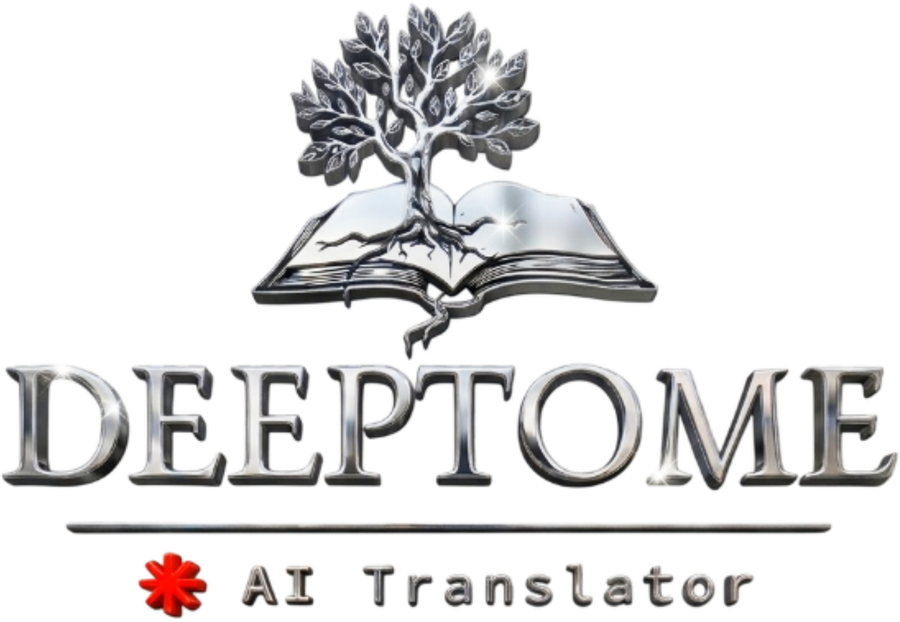
</p>

<h2 align="center">Layout-preserving neural machine translation for scientific PDFs and books</h2>

<p align="center">
  
  
  
  
</p>
<p align="center">
  
  
  
  
</p>

<p align="center">
  <a href="#1-executive-summary">Summary</a> ·
  <a href="#2-see-it-working">Demo</a> ·
  <a href="#part-i-visual-user-guide">User guide</a> ·
  <a href="#part-ii-engineering-report">Engineering report</a> ·
  <a href="#part-iii-nlp-laboratory-real-measurements">NLP lab</a> ·
  <a href="#part-iv-challenge-log">Challenge log</a> ·
  <a href="#24-open-problems-and-limitations">Open problems</a> ·
  <a href="README_fa.md">فارسی</a>
</p>

---

## 1. Executive summary

A scientific PDF isn't just text. It has columns, displayed equations, inline maths like `σ ∈ [0, 1]`, figures with labels, tables, captions, citations, running heads, margin notes, author lists and a reference section. All of that has to survive the translation. Online translators and chat assistants give back **plain text** and lose the page.

**DeepTome** reads the *layout* of every page and translates only the running text. It uses a multilingual transformer that runs **offline on an ordinary CPU**. Every paragraph is typeset back **at its original place**, with its original size, weight, colour, alignment and line spacing. Equations, figures, tables and lines stay the original **vector objects**. For Persian, the page is mirrored: text runs right to left, two-column pages swap their columns, and English terms keep their own direction inside Persian sentences. The reverse direction (Persian → English, German, French, Spanish) is mirrored the same way.

| | |
|---|---|
| **Problem** | Machine translation of layout-rich technical documents without destroying the layout, the mathematics or the terminology. |
| **Approach** | Document understanding (PyMuPDF) → term & maths protection with placeholders → sentence-level NMT (MADLAD-400 3B, CTranslate2 int8) with automatic hallucination control → bidirectional re-typesetting into the original page. |
| **Languages** | English · Persian · German · French · Spanish, every direction (20 pairs). Origin language detected automatically. |
| **Engines** | Built-in MADLAD-400 3B / NLLB-200 (offline) · Ollama (Gemma, Qwen … offline) · any OpenAI-compatible API. One pipeline for all of them. |
| **Privacy** | The built-in engine runs on the user's CPU: no account, no key, no upload. |
| **Robustness** | Parts of 2 pages, a SHA-1 sentence cache with atomic writes, resume after a crash or power cut, a 700-page limit, 20-page output files on slow PCs. |
| **Product** | Windows desktop app: PDF books **and subtitle files**, live workload chart, technical-terms review, a live page editor, Quick translate with voices and microphone, **Live translation** of films and calls, a components manager, illustrated help in 5 languages, one-file setup. |
| **Code** | One Python module, ≈ 13 800 lines, plus a WPF/PowerShell installer. Every measurement in this README was produced on the author's 4-core laptop. |

### What is new in 3.5

| | |
|---|---|
| **Subtitles** | `.srt` `.vtt` `.ass` `.ssa` `.sbv` `.sub` are recognised automatically. Only the spoken text is translated; numbers, times, styles, positions and tags stay byte-for-byte, the output is a subtitle file of the same kind ([§ 6.6](#66-subtitle-files)). |
| **Live translation** | Quick translate turns into two thin always-on-top strips: what is heard (a film, a video, a call) and its translation, with a *summary* switch and a daily transcript file ([§ 6.3](#63-quick-translate-and-live-translation)). |
| **Voices and microphone** | Offline Piper voices for all five languages (installed by Setup), online Microsoft Edge voices, Windows voices; 🎤 dictation without time limit (offline Whisper). |
| **Settings** | A components manager: every engine, model, voice and speech model with its status and size, installed or removed with one click ([§ 6.7](#67-settings-components-voices-speech-system)). |
| **Live review editor** | One selection at a time (Esc clears), drag blocks, frame *anything* by dragging on an empty spot, arrow keys and exact X / Y in pt or mm, every change visible at once and re-typeset automatically ([§ 6.2](#62-review-and-layout-editor)). |
| **Persian input** | All text boxes where Persian is typed are native Windows RichEdit controls, so right-to-left typing and cursor movement are correct ([C-20](#c-20-tk-has-no-bidirectional-text-input)). |
| **Faster start** | The engine starts about 2 minutes sooner: the MADLAD tokenizer is read with `sentencepiece` alone ([C-21](#c-21-two-minutes-lost-in-import-transformers)). |

<details>
<summary><b>Key figures (measured)</b></summary>

| Quantity | Value | Where it comes from |
|---|---|---|
| Model parameters | **2 940 374 016** (encoder 1 335 952 896) | `sum(p.numel())` of the checkpoint |
| Vocabulary | **256 000** SentencePiece pieces, d_model 1024, 16 heads × 128, d_ff 8192 (gated-GELU), 32 + 32 layers | `config.json` of MADLAD-400 3B |
| Size on disk | 11.76 GB (float32 checkpoint) → **2.77 GB** (int8 CTranslate2) | one-time conversion, 397 s |
| Load time of the engine | **8.6 s** | `ctranslate2.Translator(...)` |
| Decoding speed, 4-core CPU | **8.4 tokens/s** greedy · **5.1 tokens/s** beam 2 ("Best quality", 1.66× slower) | 31 sentences of a real page, 1 213 → 1 183 tokens |
| Cross-lingual vectors | cosine **0.854** for the same sentence in 5 languages vs **0.604** for different sentences | mean-pooled encoder states, [§ 21](#21-the-embedding-space-is-language-independent) |
| Terminology resources | 625 built-in terms · 146 Persian glossary entries · 110 Persian / 65 German standard headings · 13 automatic pattern classes | `book_translator.py` |
| Hallucination checks | 9 tests per output sentence, 4-step retry ladder | [§ 11](#stage-8--hallucination-control) |
</details>

---

## 2. See it working

### 2.1 A complete run, filmed in the real application

<p align="center">
  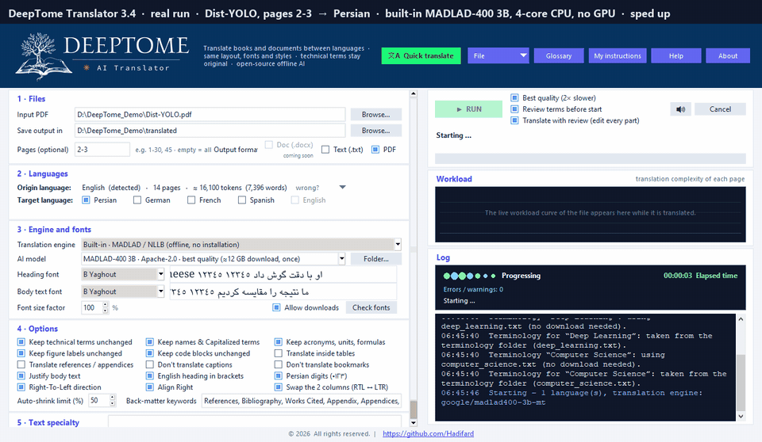
</p>

<sub>A real job, recorded frame by frame from the application window (sped up). The input is the article *Dist-YOLO*, pages 2–3, translated into Persian by the built-in MADLAD-400 engine on a 4-core laptop with no GPU. The clip shows the technical-terms review, the live workload chart, the log, a stop in the page editor and the finished file. A full-quality MP4 is at [`docs/images/demo/deeptome_demo.mp4`](docs/images/demo/deeptome_demo.mp4).</sub>

### 2.2 Original and translation, page by page

<p align="center">
  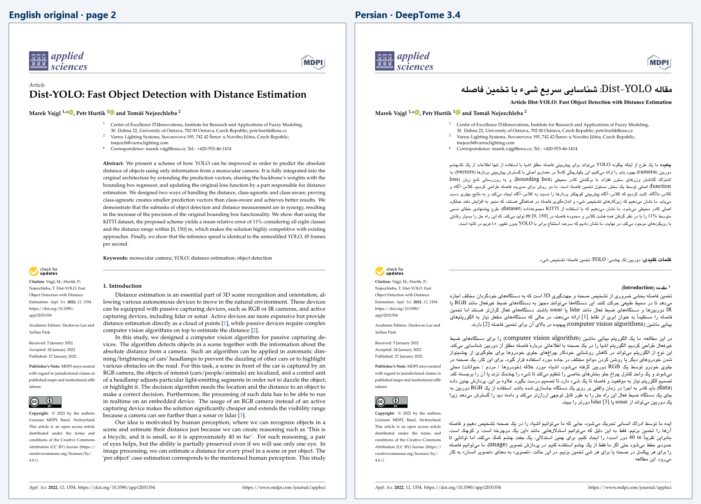
</p>

<sub>Page 2 of *Dist-YOLO: Fast Object Detection with Distance Estimation* (M. Vajgl, P. Hurtik, T. Nejezchleba, *Applied Sciences* 2022, 12, 1354, licence CC BY 4.0), translated by DeepTome 3.4. Logo, author names, affiliations, the margin notes, citations `[1]`, the abbreviations RGB / IR / lidar / sonar and the licence block are original content. The title is translated and the original title is printed under it. The first use of each glossary term is written *Persian (English)*.</sub>

### 2.3 One page, five languages

<p align="center">
  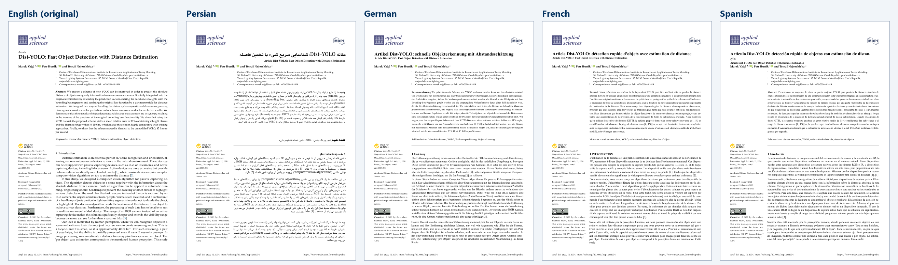
</p>

<sub>The same page, translated by the same pipeline into Persian, German, French and Spanish. Latin-script targets keep the fonts of the original document and get automatic hyphenation. German shrinks the text to 94 % of its size, French and Spanish to 95 %, because these languages are longer than English.</sub>

### 2.4 Persian → English: the mirror direction

<p align="center">
  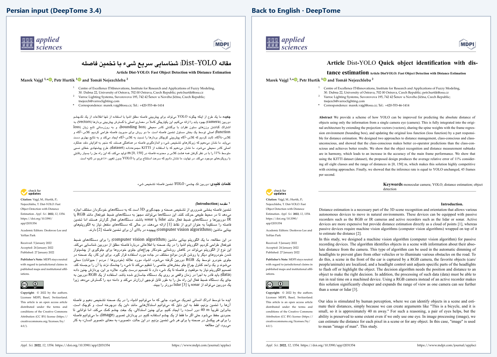
</p>

<sub>The Persian page produced above, given back to DeepTome as input (a translation of a translation, so the English is not the original wording). The language is detected from the letters. The text runs left to right again, a paragraph that started at the right margin now starts at the left, Persian digits become 0–9, and the English terms inside the Persian text are kept. This direction found two defects while this README was written: digits inside maths units stayed Persian, and the heading «چکیده» was translated as *"It's stuck."* Both are fixed ([C-18](#c-18-the-reverse-direction-persian--english)).</sub>

<details>
<summary><b>More pages: inline maths, equations, figure pages (click)</b></summary>

| | |
|---|---|
| 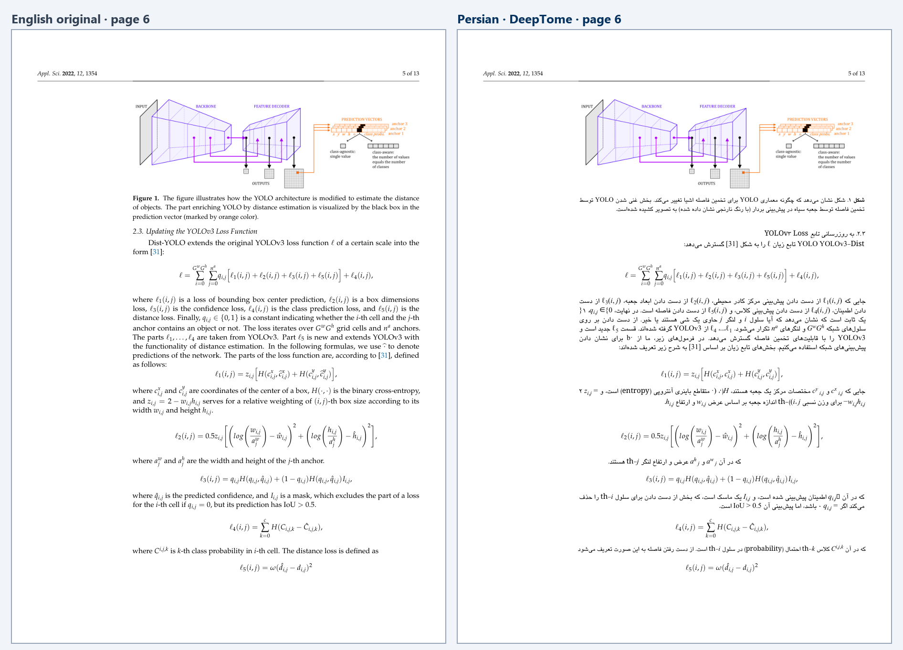 | 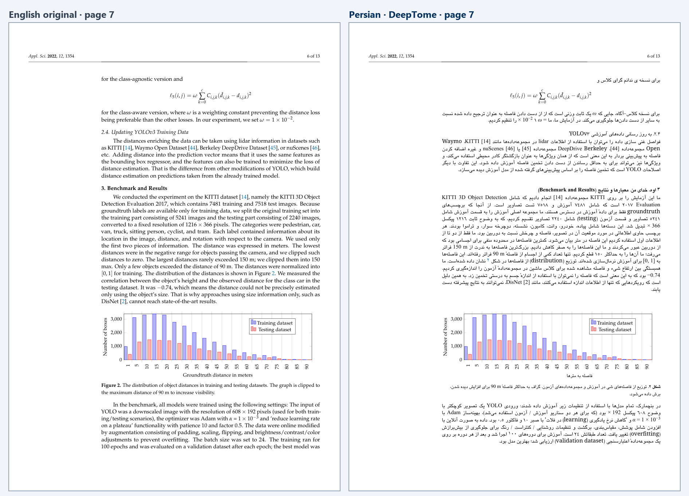 |
| Page 6: the loss function. Displayed equations are untouched vector content; inline symbols such as `ℓ1(i, j)` or `qi,j ∈ {0, 1}` travel with their sentence as protected units. | Page 7: a figure page. Labels inside the figure and the rotated axis texts are left alone; the caption is translated. |
| 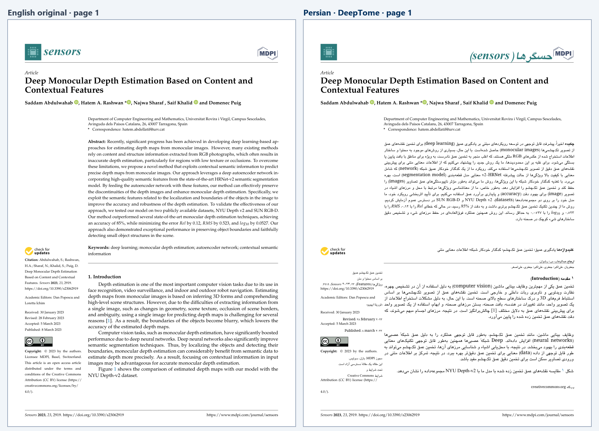 | 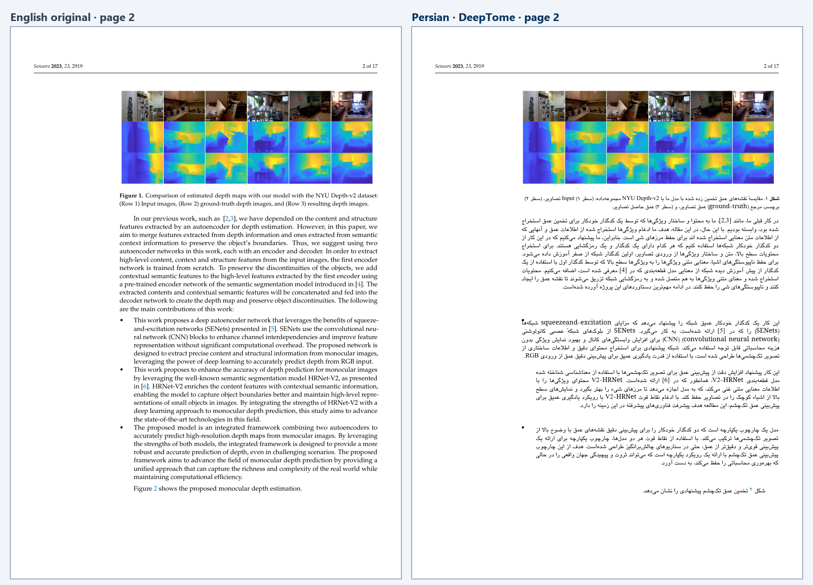 |
| *Deep Monocular Depth Estimation Based on Content and Contextual Features* (*Sensors* 2023, CC BY), page 1. | Page 2 of the same article, two columns mirrored for Persian. |

<sub>These four pages were made with an older version (3.1, 16 November 2026). A few defects that were fixed later are still visible in them, for example a margin note that was translated. [Part IV](#part-iv-challenge-log) explains each of them.</sub>
</details>

---

## Contents

- [Part I: Visual user guide](#part-i-visual-user-guide)
  - [3. Installation](#3-installation) · [4. The main window](#4-the-main-window) · [5. Section by section](#5-section-by-section) · [6. Windows and tools](#6-windows-and-tools) · [7. Output files](#7-output-files-and-names)
- [Part II: Engineering report](#part-ii-engineering-report)
  - [8. Architecture](#8-architecture) · stages [0](#stage-0--intake-and-language-identification) to [12](#stage-12--parts-cache-and-recovery) · [13. LLM engines](#13-llm-engines) · [14. Review editor internals](#14-review-editor-internals) · [15. Quick translate and speech](#15-quick-translate-and-speech) · [16. Installer](#16-installer)
- [Part III: NLP laboratory (real measurements)](#part-iii-nlp-laboratory-real-measurements)
- [Part IV: Challenge log](#part-iv-challenge-log)
- [24. Open problems and limitations](#24-open-problems-and-limitations) · [25. Performance](#25-performance) · [26. Project structure](#26-project-structure) · [27. Roadmap](#27-roadmap) · [28. References](#28-references) · [29. Licence and contact](#29-licence-and-contact)

---

# Part I: Visual user guide

## 3. Installation

### For users: one file

<p align="center"></p>

`DeepTome_Setup.exe` (under **Releases**) installs everything on a computer that has nothing installed. It installs a private Python, the program packages and the engines you tick, and creates a desktop shortcut and an uninstaller. The setup shows the **exact download** before it starts:

| Component | Download | Notes |
|---|---|---|
| Python 3.12 (private copy) | 42 MB | does not touch another Python on the computer |
| Program packages | 289 MB | PyMuPDF, CTranslate2, transformers, sentencepiece, fontTools … |
| Built-in engine MADLAD-400 3B | 11.78 GB | downloaded once, converted to int8 (2.8 GB on disk); needs ≈ 16 GB RAM for the one-time conversion |
| Ollama (optional) | 1.86 GB | local LLM runtime |
| Gemma 3 4B for Ollama (optional) | 3.35 GB | |

The default is **Advanced** (all engines). **Standard** and **Small** install less. Downloads resume after an interruption.

### For developers: source

```bash
git clone https://github.com/Hadifard/DeepTome-Translator.git
cd DeepTome-Translator
python -m pip install -r requirements.txt
python book_translator.py                       # desktop app
python book_translator.py --cli paper.pdf -l fa -o out --formats pdf,txt     # command line
```

The model is downloaded and converted the first time it is needed. After that the app works without internet.

---

## 4. The main window

<p align="center">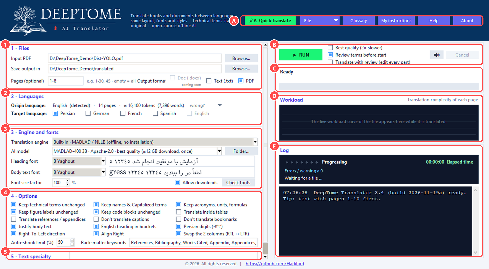</p>

| # | Part | What it does |
|---|---|---|
| **A** | Header | **Quick translate** (green), **File** (New, History, Settings, Exit), **Glossary**, **My instructions**, **Help**, **About**. |
| **1** | Files | Input PDF, output folder, optional page range, output formats. |
| **2** | Languages | The origin is **detected** (with pages, words and tokens); you tick the target. |
| **3** | Engine and fonts | Built-in / Ollama / online API, the AI model, heading and body fonts with live samples, font-size factor. |
| **4** | Options | 15 switches plus the auto-shrink limit and the back-matter keywords. |
| **5** | Text specialty | Up to 4 fields (e.g. *Chemistry, AI*). Their terminology is collected and kept. |
| **B** | RUN | Start; *Best quality*, *Review terms before start*, *Translate with review*; sound on/off; Cancel. |
| **C** | Status | Page · part · status, remaining time, progress bar. |
| **D** | Workload | Live chart of the translation complexity of every page region. |
| **E** | Log | Time-stamped log; everything can be selected and copied. |

<details>
<summary>The empty window right after start</summary>
<p align="center">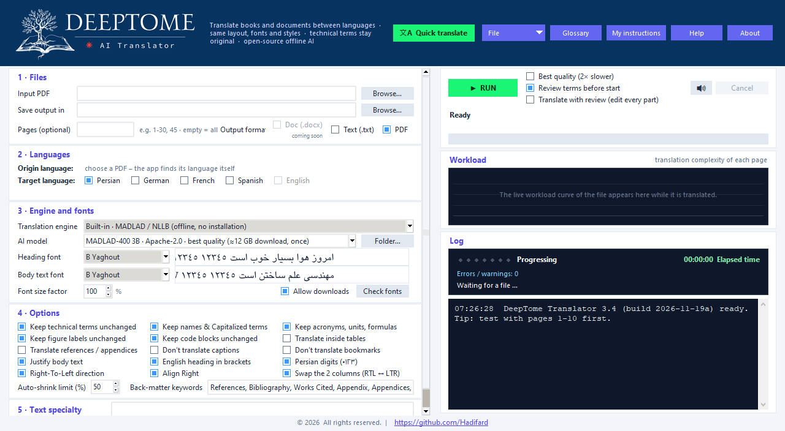</p>
</details>

---

## 5. Section by section

### 5.1 Section 1 · Files

<p align="center">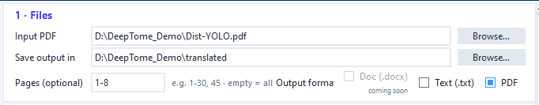</p>

* **Input PDF**: a PDF with real (selectable) text. Scanned books need OCR first.
* **Save output in**: the output folder. Names are built automatically (see [§ 7](#7-output-files-and-names)).
* **Pages (optional)**: `1-30, 45`, `41–44`, `41 to 44` and `41_44` are all understood (`parse_pages`). The result contains **only** these pages.
* **Output format**: **PDF** (the original page with the translation typeset into it) and **Text (.txt)**. *Doc (.docx)* is implemented in the code (`write_docx`) but switched off in the window ("coming soon") until its layout quality matches the PDF.

### 5.2 Section 2 · Languages: automatic origin detection

| English file → Persian | Persian file → German |
|---|---|
| 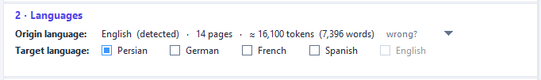 | 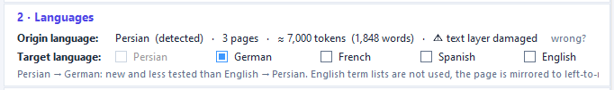 |

As soon as a file is chosen, a background thread reads it (`file_stats`) and shows:

* **the language**, found from its letters and its most frequent words (see [Stage 0](#stage-0--intake-and-language-identification)). **wrong?** corrects it by hand.
* **pages, words and tokens.** Tokens are counted with the model's own SentencePiece tokenizer when it is installed, otherwise estimated at 2 tokens per word. The example shows 14 pages, 7 396 words and ≈ 16 100 tokens.
* **"text layer damaged"** when the PDF's characters can't be read back. The right-hand screenshot shows this warning for a Persian file written by an older DeepTome version (see [challenge C-01](#c-01-persian-output-had-an-unreadable-text-layer)).

Exactly one origin and one target are active. The language chosen in one row is greyed out in the other. Tick boxes are drawn as filled blue squares (`#3D98FF`).

### 5.3 Section 3 · Engine and fonts

| Built-in (default) | Ollama | Online API |
|---|---|---|
| 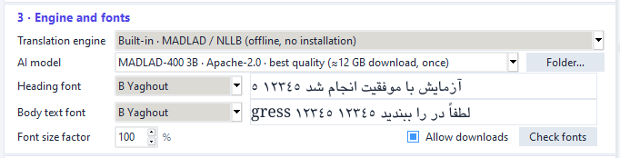 | 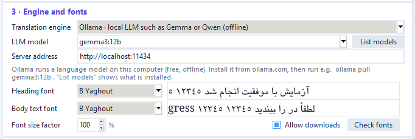 | 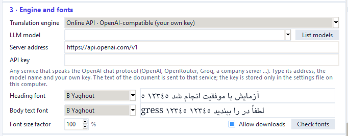 |

* **Built-in · MADLAD / NLLB**: MADLAD-400 3B (Apache-2.0, best quality), NLLB-200 1.3B or 600M (CC-BY-NC, faster). **Folder…** uses a model folder that is already on the disk.
* **Ollama**: model name (Gemma 3 12B is suggested for Persian), server address, **List models** shows what is installed.
* **Online API**: any server that speaks the OpenAI chat protocol: address, model, **API key** (masked, stored only in the local settings file, never written to the log).
* **Heading font / Body text font**: for Persian, B Yaghout by default and more than 25 Persian fonts, or any `.ttf/.otf`. Every font shows a live sample that can be scrolled with the mouse wheel. For Latin targets the default is *same as the original document*:

<p align="center">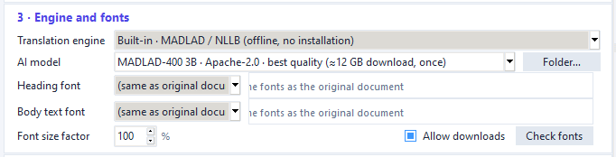</p>

* **Font size factor**: 100 % keeps every size exactly as in the original (18 / 12 / 10 pt stay 18 / 12 / 10 pt). Terms that are not translated always keep their original size.
* **Allow downloads**: fonts and the model may be fetched once. **Check fonts** shows which chosen fonts were found.

### 5.4 Section 4 · Options

<p align="center">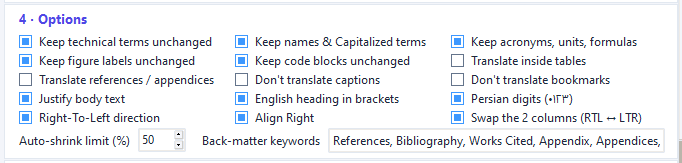</p>

| Option | Default | What happens in the code |
|---|:---:|---|
| Keep technical terms unchanged | ✔ | `Protector` masks the 625 built-in terms, the glossary, the specialty terms and the user's terms as placeholders. |
| Keep names & Capitalized terms | ✔ | `_name_spans`: Capitalized and compound-Capitalized words inside a sentence (*Hugging Face*, *Kaggle*). A lone capital at the start of a sentence is grammar and is translated. Off for German / Persian origins. |
| Keep acronyms, units, formulas | ✔ | 13 regex classes (`_AUTO_RES`): section numbers, URLs, e-mails, citations, units (`5 kHz`), identifiers (`snake_case`, `func()`), camelCase, part numbers (`LM741`), versions, maths with relations, symbols, acronyms. |
| Keep figure labels unchanged | ✔ | Short text inside drawing clusters / images is classified `figure label` / `text inside image`. |
| Keep code blocks unchanged | ✔ | Monospaced paragraphs are classified `code`. |
| Translate inside tables | ✘ | Off: `page.find_tables()` plus a fallback grid detector mark table text as kept. |
| Translate references / appendices | ✘ | Off: everything after the first *References / Bibliography / Appendix / Glossary / Index* heading in the last 60 % of the book is kept. |
| Don't translate captions | ✘ | Captions (*Figure 3:*, *Table 2.*) are translated by default. |
| Don't translate bookmarks | ✘ | The PDF outline is translated by default (`_translate_bookmarks`). |
| Justify body text | ✔ | Body paragraphs justified; headings, titles and captions keep their alignment. |
| English heading in brackets | ✔ | `۵ نتیجه‌گیری (Conclusion)`; the document title gets its original printed **under** the translation at 55 % size. |
| Persian digits (۰۱۲۳) | ✔ | Latin digits in the translation become Persian digits (Persian target only). |
| Right-To-Left direction | ✔ | `direction: rtl` for Persian paragraphs. |
| Align Right | ✔ | An *Align Left* paragraph of the original becomes *Align Right* (and the other way round for Persian → Latin). |
| Swap the 2 columns (RTL ↔ LTR) | ✔ | `swap_columns_pdf` exchanges the halves of every two-column band of the page. |
| Auto-shrink limit (%) | 50 | A translation that is longer than its box is shrunk, but never below this factor. |
| Back-matter keywords | References, … | The headings that start the untranslated back matter. |

### 5.5 Section 5 · Text specialty

Type up to four fields (`Chemistry, Deep Learning`). DeepTome looks up the terminology of these fields on Hugging Face, Kaggle and Wikipedia, stores one list per field (refreshed after 30 days, then usable offline) and keeps those terms in the original language. **Also detect the subject** lets the app work out the field of the book by itself.

### 5.6 RUN, status, workload chart

<p align="center"> 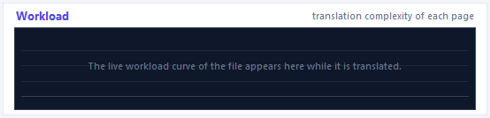</p>

* **Best quality (2× slower)**: beam search with 2 hypotheses instead of greedy decoding. It has its own cache, so ticking it really translates again. Measured: 1.66× slower.
* **Review terms before start**: shows the technical terms found in this file before the job starts ([§ 6.1](#61-technical-terms-review)).
* **Translate with review**: after every part (2 pages) the page editor opens ([§ 6.2](#62-review-and-layout-editor)).
* **Status line**: `Page 007 / 034 · Part 4 of 17 · Status: translating …`. The remaining time is estimated from **words still to translate × seconds per word measured in this job**, falling back to the average of earlier jobs on this computer during the first pages.
* **Workload chart**: every page is cut into 8 slices. The dotted blue line is the amount of text waiting, the green line is the time really spent. Four pages are visible; the chart follows the work, and it can be dragged or scrolled back (double-click = follow again).
* **Sounds**: one sound after every part, another when the file is ready and another on Cancel. The speaker button switches them off.

---

## 6. Windows and tools

### 6.1 Technical terms review

<p align="center">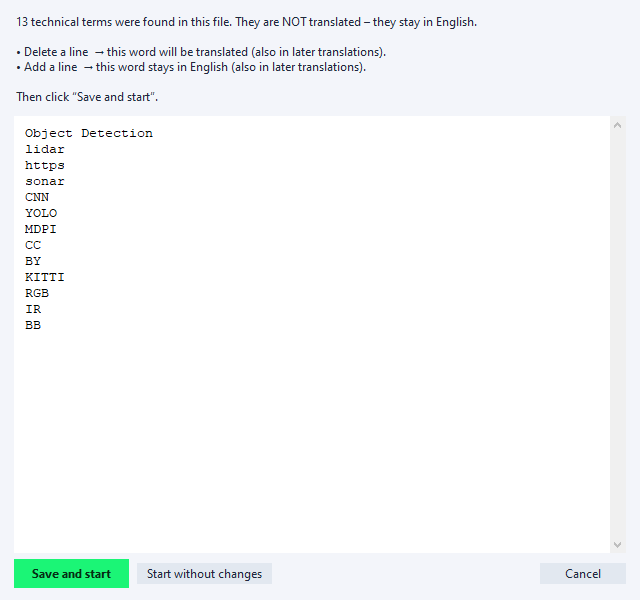</p>

Before the job starts, `scan_terms` reads the selected pages and lists every term the app intends to keep in the original language, with how often it occurs. Delete a line to have that word translated from now on; add a line to keep a word. **Save and start** stores the decision for later jobs too.

For an origin other than English the dialog is different (`_terms_dialog_foreign`). It lists terms of the **source language** (for example Persian noun phrases found by a stop-word-bounded n-gram scan) and lets you choose, per term: *keep as it is*, *engine translates*, or *use my translation* in the target language. The choice is saved as `de | term = translation`.

### 6.2 Review and layout editor

With *Translate with review* the job stops after each part and shows the pages **exactly as they will be saved**. Since 3.5 every change is visible at once and the part is typeset again by itself a moment later; nothing waits for a *Save* button.

| Select a block: its place in pt / mm, formats, text | A frame drawn on an empty spot (the logo) moved with Shift + ↓ |
|---|---|
| 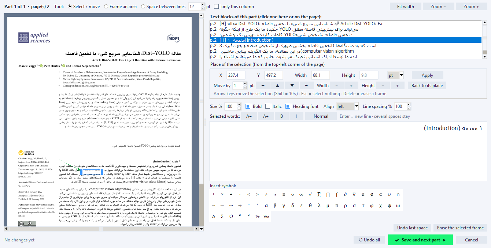 | 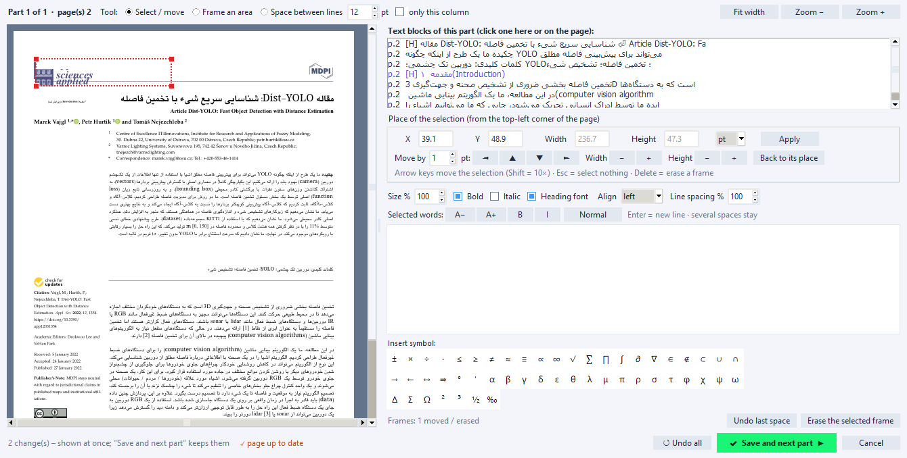 |

* **One selection at a time**: a text block *or* a framed area. **Esc** selects nothing, and changing the tool lets go of everything, so the page is clean. Nothing is selected when the window opens.
* **Move**: drag with the mouse (a click that moves less than 5 px is only a click), the arrow keys (1 pt, **Shift** = 10 pt, step adjustable), ◄ ▲ ▼ ►, or type **X, Y and width** measured from the **top-left corner of the page**, in pt or mm.
* **Frame anything**: drag on an empty place (or use the *Frame an area* tool over text) around author names, a logo, a table row, a picture. The frame becomes the selection and moves like a block; **Delete** erases it.
* **Instant preview, exact result**: while you drag, the moved piece of the page picture is shown at its new place (a crop of the rendered page, white where it was). After the mouse is released (or 0.6–1.2 s after the last key), the window sends the *whole* list of changes to the job. The job puts the part back to its original translation and applies all changes again (`pristine` snapshot + `apply_review_edit` + `render_part` + `apply_area_ops`), about 4–5 s per part on 4 cores. Because every update starts from the original, **Undo all** and **Cancel** are exact.
* **Text blocks**: click a block, change only the words you want (only changed words are typeset again; formulas, terms, fonts and sizes stay). **Enter** starts a new line. **Selected words**: A− / A+ / **B** / *I* / Normal. *Size %*, *Line spacing %*, *Height − / +* (content below moves with it), *Width − / +*. **Insert symbol** offers 45 maths and Greek symbols. The editor is a native right-to-left text box.
* **Space**: click between two lines to insert room (+pt) or remove it (−pt), across the whole width or *only this column*.
* **Save and next part** keeps all changes · **Undo all** · **Cancel** = keep the part as it was translated.

### 6.3 Quick translate and Live translation

| Quick translate (no title bar, any size) | Live translation strips (always on top) |
|---|---|
| 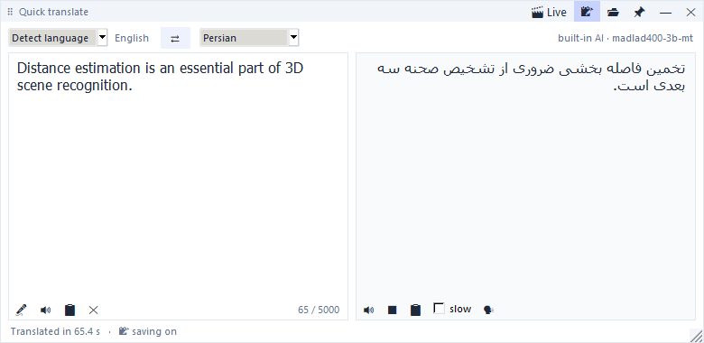 | 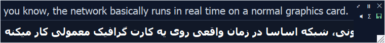 |

* A small window **without a title bar**: drag its top strip, resize it from the corner down to 340 × 200 px; in a narrow window the two boxes go one above the other.
* Type, paste or **speak** (🎤, offline Whisper, no time limit) up to 5 000 characters; the translation follows 0.6 s after you stop. Persian is typed correctly (native RichEdit box).
* The offline model **starts loading the moment the window opens**, so it is usually ready when you have finished typing; the window says how long it took.
* 📝 saves every finished translation (original + translation, with the time) to `Documents\DeepTome\Quick translations\Quick_translations_<date>.txt`; a translation counts as finished when the text has stayed the same for 4 s, so half-typed sentences are not saved.
* 🔊 reads aloud with the voice chosen in Settings; ■ stops; *slow* reads at 0.75×.
* **🎬 Live** turns the window into two strips on top of every window. The upper strip shows the words that are being heard (from the sound of the computer or the microphone), the lower one their translation, sentence by sentence. When a line is longer than the strip the newest words stay in view: English slides out to the left, Persian to the right. **Σ summary** removes fillers, repeated words and side remarks before translating; **💾** writes a daily transcript with a framed header per session (date, start time, languages, sound source) and a time stamp per sentence. ⤢ goes back to the normal window to change the languages.

### 6.4 Glossary and *My instructions*

| Glossary | My instructions |
|---|---|
| 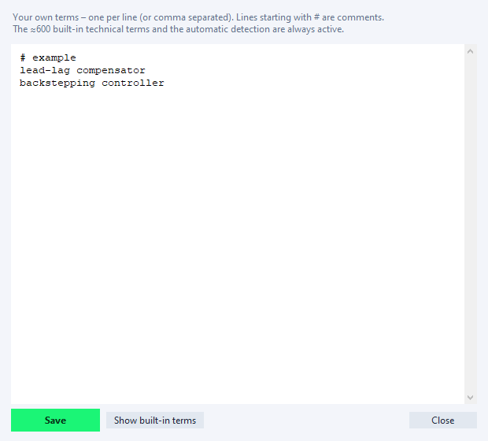 | 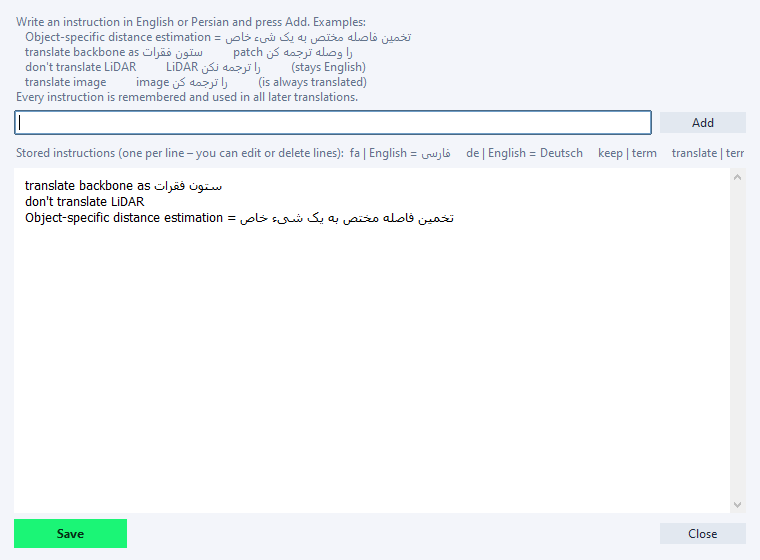 |

* Both windows show **every earlier entry in a list with its date**; click a line to see it, change it or delete it (several lines at once with Ctrl / Shift). Every change is saved at once. Help, About, Glossary, My instructions, History and Settings open only once, however often their button is clicked.
* **Glossary**: one term per line = keep it.
* **My instructions**: plain-language rules in English or Persian, parsed by `parse_instruction`:
  `translate backbone as ستون فقرات` · `LiDAR را ترجمه نکن` · `Object-specific distance estimation = تخمین فاصله مختص به یک شیء خاص` · `translate image`.
  The newest instruction about a word wins. With LLM engines the whole text goes into the system prompt, so free instructions such as *use a formal tone* work too.

### 6.5 Help, History, About

| Illustrated quick guide (English) | The same guide in Persian | German |
|---|---|---|
| 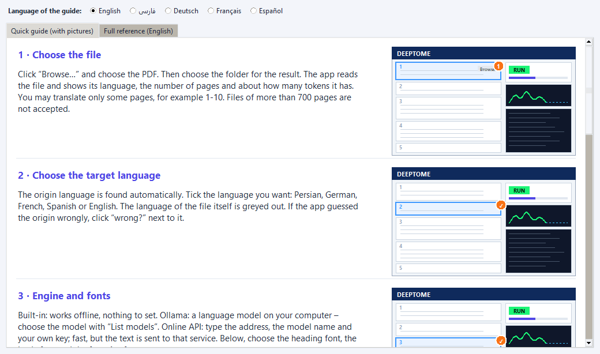 | 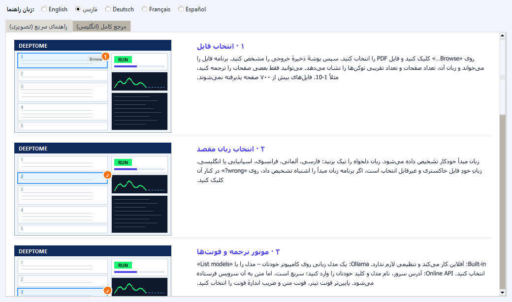 | 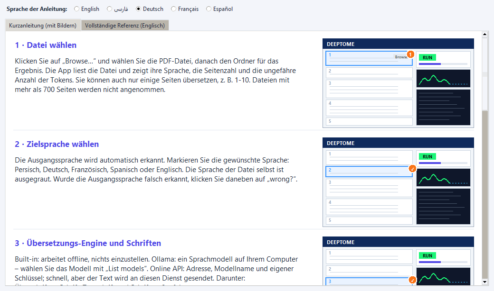 |

| Full reference | History | About |
|---|---|---|
| 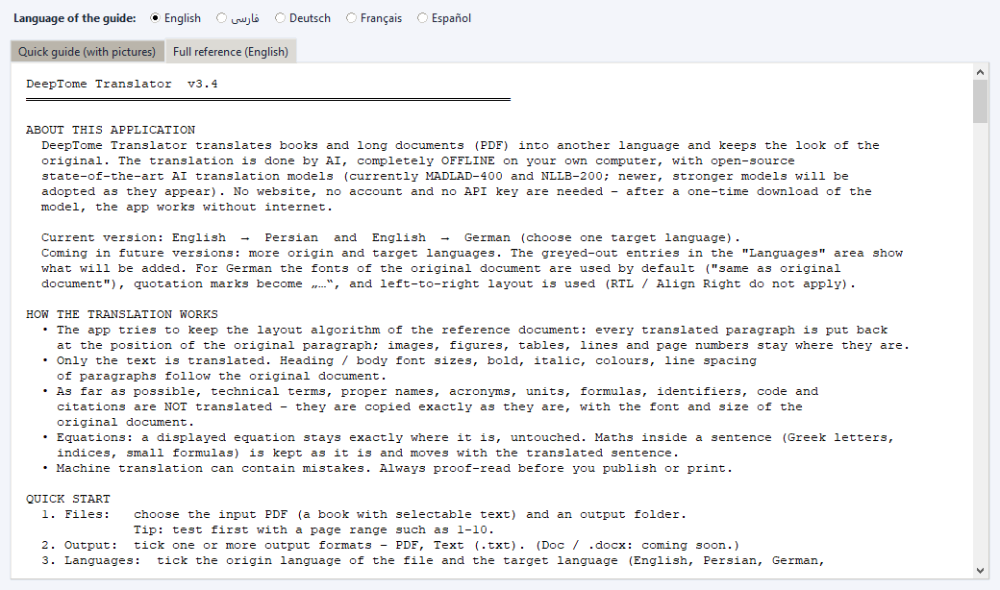 | 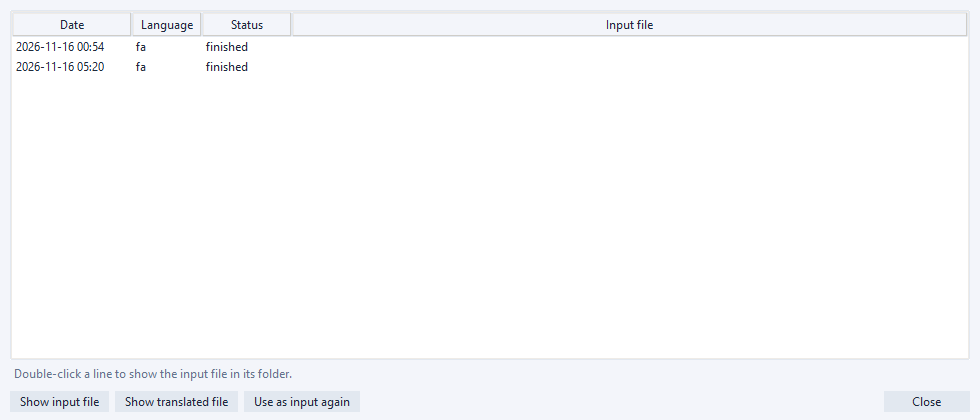 | 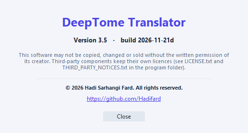 |

### 6.6 Subtitle files

| The app recognises the file | Main window in subtitle mode |
|---|---|
| 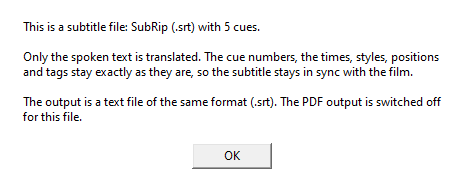 |  |

Choose a subtitle file instead of a PDF. The output switches to a subtitle file of the same kind (PDF and pages are switched off) and `run_subtitle_job` translates only the spoken text:

* `subtitle_slots` finds the text of every cue: whole lines after a timing line (SRT, WebVTT, SBV), or the text field of an ASS / SSA `Dialogue:` line (after the 9th comma, `\N` = line break), or the text after `{start}{end}` (MicroDVD, `|` = line break). Every other line is written back unchanged.
* A cue's leading and trailing tags (`<i>…</i>`, `{\an8}`, `<v Anna>`) are kept around the translation; other tags travel as placeholders; inline bold / italic of single words is dropped so that the line is always translated.
* **Sentences across cues**: up to three cues without a full stop are translated as one sentence and the translation is shared out again by the length of the original cues. **Two speakers** (`- Who are you?` / `- I'm your brother!`) are translated line by line with their dashes. Lines without letters (`♪ ♪`) stay.
* The translation is wrapped into as many lines as the original cue had. Persian lines get a right-to-left mark at both ends so that players put the punctuation on the correct side. Line ends (CRLF / LF) are kept; the file is written as UTF-8 (with BOM for players on Windows).

### 6.7 Settings: components, voices, speech, system

| Components | Voices | Speech recognition |
|---|---|---|
| 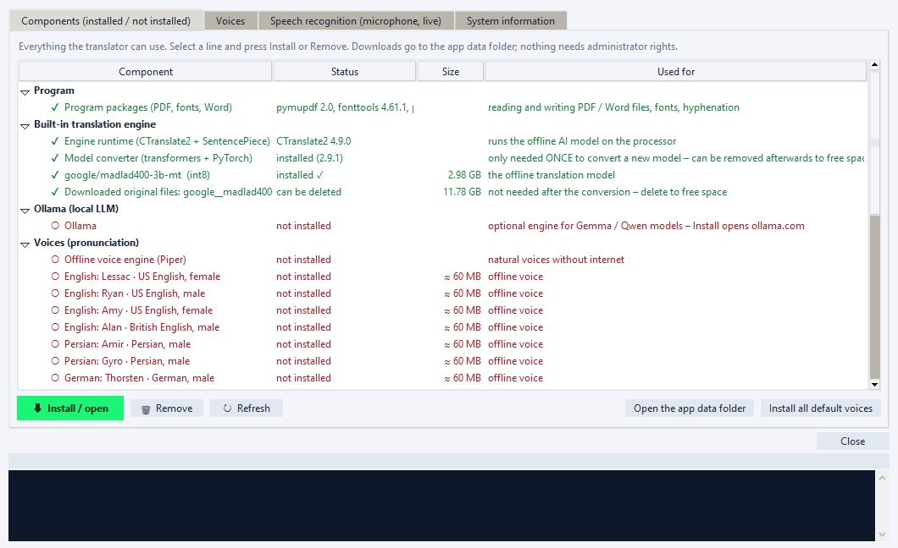 | 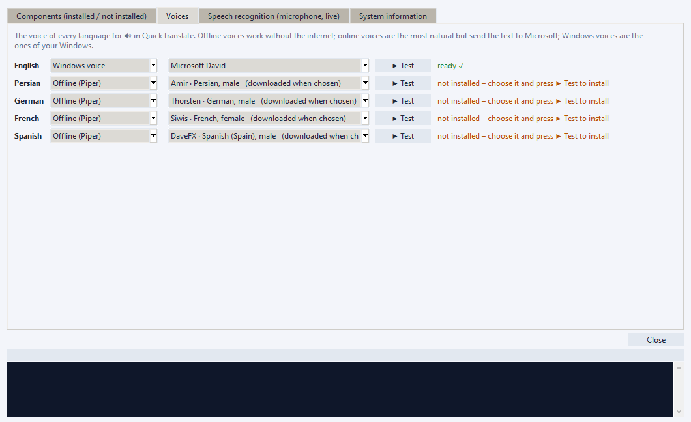 | 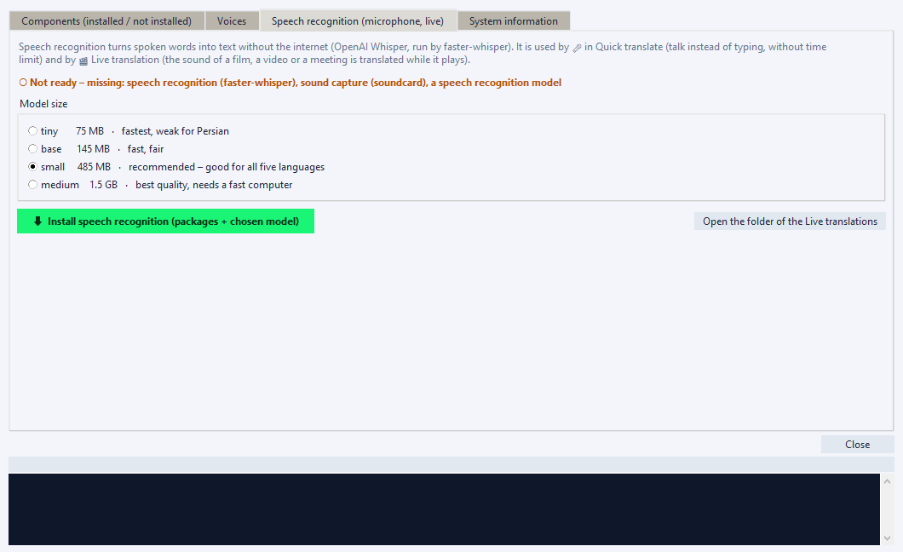 |

* **Components** lists everything the translator can use, grouped: program packages, engine runtime, model converter, every converted model (and the 11.8 GB download folder that can be deleted after conversion), Ollama and its models, the offline voice engine and every voice, online voices, Windows voices, speech recognition, sound capture, Whisper models and the data folders, each with status, size and use. **Install / Remove** work with one click (pip in the app's own Python, downloads with progress); the work runs in the background with its log in the window.
* **Voices**: per language offline (Piper), online (Microsoft Edge neural voices, the text is sent to Microsoft) or Windows; ▶ Test installs a missing voice and plays a sample.
* **Speech recognition**: model size (tiny 75 MB … medium 1.5 GB, *small* recommended for Persian) and one-click installation of faster-whisper + soundcard + model.
* **System information**: Windows, processor, cores, memory, GPU, disk, folders and the version of every package, with *Copy*.

### 6.8 Languages that are not supported yet

`detect_other_language` recognises Arabic, Urdu, Russian, Greek, Hebrew, Hindi, Thai, Korean, Japanese, Chinese, Armenian, Georgian (by script) and Italian, Portuguese, Dutch, Turkish, Polish, Swedish, Indonesian, Czech (by their most frequent words). Such a file is refused with a message; *wrong?* overrides a wrong guess.

The quick guide has 7 illustrated steps in **English, Persian, German, French and Spanish**. The drawings are generated by code (`draw_guide_picture`). Persian text is rendered through the PDF engine (`render_rtl_text`), because Tk can't lay out right-to-left paragraphs correctly.

---

## 7. Output files and names

```text
Translated_to_fa__<original name>.pdf             whole file
Translated_to_fa__<original name>_pages_2-3.pdf   page selection
…_file01of06_pages_1-20.pdf                       long job on a slow computer (one file per 20 pages)
…_01.pdf                                          the normal name was open in another program
```

Paths longer than Windows' 260-character limit are shortened automatically (`fit_output_path`), and 8.3 short paths (`D:\MYFOLD~1\…`) are expanded to real names (`long_path`).

---

# Part II: Engineering report

## 8. Architecture

<p align="center">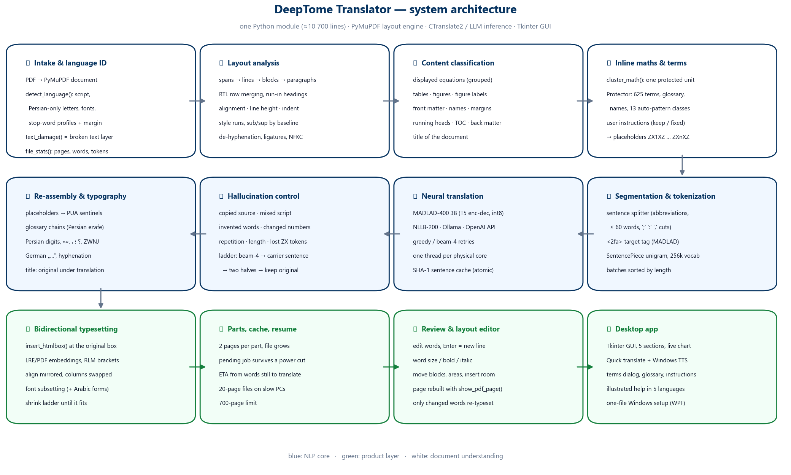</p>

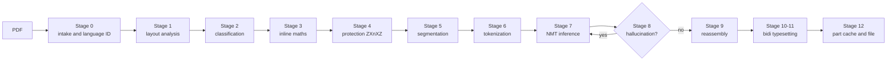

Everything runs in **one Python module**, `book_translator.py`. The desktop window runs the job in a **separate process** (`multiprocessing`, spawn) and talks to it through two queues. Progress, log lines and review requests flow up; review answers flow down. A slow model therefore never freezes the window, and *Cancel* can always stop the job.

The rest of this part follows one paragraph of the *Dist-YOLO* abstract through every stage. All intermediate values shown are real outputs of the code.

---

### Stage 0 · Intake and language identification

**Code:** `file_stats`, `detect_language`, `text_damage`, `local_tokenizer`

```python
# Author: Hadi Sarhangi Fard · Date: 2026-11-19 · book_translator.py (excerpt)
def detect_language(text, fonts=None):
    letters = [c for c in text if c.isalpha()]
    arab = [c for c in letters if _ARABIC_SCRIPT.match(c)]          # U+0600-06FF and the presentation forms
    fa_font = bool(fonts) and sum(1 for f in fonts if _RTL_FONT_RE.search(f)) >= max(1, len(fonts) // 4)
    if len(arab) >= 30 or (fa_font and len(arab) >= 5):
        norm = unicodedata.normalize("NFKC", "".join(arab))
        share = len(arab) / max(1, len(letters))
        # a damaged text layer turns the Latin part into rubbish, so the share of Arabic letters can be low
        if share > 0.35 or (share > 0.12 and (any(c in _FA_ONLY for c in norm) or fa_font)) \
                or (fa_font and text_damage(text) > 0.02):
            return "fa"
    ...                                                              # Latin languages: stop-word profiles
    score = {lg: sum(real.count(w) for w in set(ws.split())) for lg, ws in _LANG_WORDS.items()}
    best = max(score, key=score.get)
    if score[best] < 0.06 * len(real) or score[best] < 1.5 * second:   # margin test: refuse to guess
        return ""
```

* **Persian** is recognised from its script, with three refinements. (1) The letters پ چ ژ گ ک ی ۀ exist in Persian but not in Arabic. (2) Persian font names (B Nazanin, IRANSans, Vazir …) count as evidence. (3) A file whose Latin part was destroyed by a broken font table still contains a low share of Arabic letters.
* **English / German / French / Spanish** are scored with 25 high-frequency function words each. A language is accepted only if it wins by a **margin of 1.5×** and covers at least 6 % of the words. Otherwise the app says nothing rather than guessing.
* **`text_damage`** = the share of C1 control characters, private-use and replacement characters, and `¤¦§¨`. Above 2 % the window shows *text layer damaged*.
* **Token count**: the SentencePiece model of the installed translation model is loaded with the small `sentencepiece` library (2 s instead of 30 s with transformers). It is applied to up to 60 000 characters of sample pages and scaled by the word count.

### Stage 1 · Layout analysis

**Code:** `extract_page`, `_merge_rtl_rows`, `_split_block`, `_alignment`, `build_runs`, `first_line_indent`

MuPDF delivers *blocks → lines → spans*, where a span is a run of text with one font, size and colour, plus its bounding box and baseline. DeepTome rebuilds **paragraphs** from that:

1. **Lines cut in two are joined.** MuPDF splits a line at a sub- or superscript (`where L` | `ᵢc(r) is the photometric loss`), and it often makes a run-in heading (`Input and Output.` + the text after it) a block of its own on the same row. Two pieces on one row (`_same_row`: vertical overlap > 50 %, centres closer than 0.6 × line height) with a gap smaller than 1.2 × font size (2.5 × after a bold or colon-ended run-in heading) are glued. Numbered list labels are never glued.
2. **RTL rows.** In a Persian PDF MuPDF cuts every row at each direction change and each zero-width joiner. `_merge_rtl_rows` joins the pieces of one row again in reading order. It inserts a ZWNJ where two letter pieces touch (< 0.12 em) and a space otherwise, and un-mirrors brackets that come out reversed (`)…(` → `(…)`). For the paragraph rules the lines are then seen **in a mirror** (`_ltr_view`: x ↦ −x), so all rules written for left-to-right text hold unchanged.
3. **Paragraphs inside a block** (`_split_block`). A new paragraph starts when the vertical gap is more than 0.55 × font size, when a justified line ends 1.5 em before the right edge (the last line of a paragraph), or when a line is indented by more than 0.8 em while the previous one was flush (a first-line indent).
4. **Alignment** (`_alignment`). Left edges within 2.5 pt and right edges within 2.5 pt over more than 2 lines → *justify*. Equal centres → *center*. Equal right edges only → *right*.
5. **Line height** = median baseline pitch ÷ dominant font size, clamped to [1.0, 2.2]. **First-line indent** = between 0.6 and 6 em.
6. **Style runs** (`build_runs`). Spans with equal (size, bold, italic, colour, mono, vertical alignment) are merged. **Sub/superscripts** come from the *baseline*: the baseline of a line is the one that carries most characters, and a span raised by more than 0.15 em (if smaller) or 0.28 em is `sup`. **De-hyphenation**: `trans-` + `lation` becomes `translation` when the next line starts lower-case; soft hyphens are removed.
7. **Clean-up** (`_fix_lig`). Ligatures `fi fl ff` are expanded; Arabic Presentation Forms are normalised to base letters with NFKC (and ي/ك → ی/ک); control characters (Springer puts a BEL between a heading number and its title) are removed; special spaces are normalised; maths letters lost in a broken character table are repaired ([C-07](#c-07-greek-letters-printed-as-korean-syllables)).

### Stage 2 · Content classification

**Code:** `looks_like_formula`, `_formula_line`, `group_equations`, `mark_text_grid_tables`, `mark_front_matter`, `names_line`, `mark_names_margins_title`, `mark_running_heads`, `find_back_matter`, `mark_fractions`

Every paragraph gets a `skip` reason or `None` (= translate). The *Dist-YOLO* pages, as classified by the real code:

| Page | translate | kept, with reason |
|---|---:|---|
| 1 (cover) | 1 | cover page 2 · names of persons 2 · URL 1 · numbers 2 |
| 2 (abstract) | 7 | **margin note 17** · front matter 7 · names 1 · URL 2 · formula 2 · numbers 2 |
| 6 (loss function) | 8 | **formula-like 7** |
| 7 (figure) | 8 | **rotated text 20** · figure label 3 · numbers 4 · formula 2 |
| 8 | 14 | formula 4 · names 2 |

* **Displayed equations.** A line is a formula line when it is set mainly in a maths font (`CMMI`, `CMSY`, `STIX`, `Cambria Math` …), or is built from `= ∑ ∫ ≤ ∈` with hardly any real words, or ends in an equation number `(12)`. *Real words* are counted with English stop-words: three of them (`is`, `the`, `of`) make a line a sentence however much maths it contains. `group_equations` then joins the main row, the fraction / limit fragments, a stray exponent and the number `(n)` **within one column** into a single block. A displayed equation is never erased and never re-typeset: it stays the original vector content.
* **Tables**: `page.find_tables()`, plus a detector for tables without ruling lines (≥ 3 rows of ≥ 2 short single-line cells with aligned left edges).
* **Figures**: raster images (`get_image_info`) and vector drawing clusters (`cluster_drawings`, ≥ 4 drawings). Short labels inside them are kept.
* **Front matter / names**: author lines (`Marek Vajgl 1,*, Petr Hurtik 1 and Tomáš Nejezchleba 2`, `Edited by Dr. …`) are recognised by `names_line`, a small grammar of name tokens, affiliation marks and separators. **Names are never sent to the model**, because it replaces unknown names with famous ones ([C-02](#c-02-invented-names-and-a-fake-citation-in-the-margin)).
* **Margin notes**: blocks outside the x-range of the main text column (computed from paragraphs of ≥ 3 lines at body size).
* **Title**: the largest paragraph of the first page. Multi-line titles are merged and the original is printed under the translation.
* **Back matter**: the first heading matching the back-matter keywords in the last 60 % of the book. Its position is stored and reused by all later parts.
* **Inline fractions** (`mark_fractions`): a fraction inside a sentence has a *drawn* bar, not a text bar. The expression is copied as a picture and the bar is erased ([C-05](#c-05-german-fraction-bar-left-behind)).

### Stage 3 · Inline mathematics

**Code:** `cluster_math`, `_mathy`, `_glue`, `_glue_prefix`, `_glue_suffix`, `_glue_inside`, `_hard_math`

Maths inside a sentence (`w_ij = exp(−d²/2σ²)`, `λ ∈ [0, 1]`, `ℓ1(i, j)`) must neither be translated nor be torn apart by the right-to-left reordering of a Persian sentence. `cluster_math` scans the style runs:

* A run is *mathy* if it is a sub/superscript of ≤ 12 characters, is set in a maths font, is a single bold letter (a vector), is a Greek or letter-like symbol, or is a single italic letter.
* Two mathy runs are one expression if what lies between them is **glue**: operators, digits, brackets, Greek, function names (`exp`, `log`, `sin` …) and single letters. Inside brackets, commas belong to the expression (`c(x; d, n, h)`, `[0, 1]`); outside, `, ` ends it, so `α, β` stays two units. Bracket **depth** is tracked across runs, so `σ ∈ [` + `0, 1` (text font) + `]` (another font) becomes one unit. If a bracket never closes, the runs taken on trust are given back.
* The unit keeps **every original run** with its font, size, italic and vertical alignment (`Run.parts`). It is re-typed exactly as it was, with non-breaking spaces, inside a left-to-right embedding. Glyphs without Unicode meaning (private-use codes of old TeX fonts) are copied as a 300-dpi picture of the original page (`CropSource`).

### Stage 4 · Terminology protection and placeholder masking

**Code:** `Protector`, `_build_item`, `prepare_para`, `merge_cites`, `_prepare_heading`

Every span that must survive unchanged is replaced by a placeholder token **`ZXnXZ`**. This is the real abstract paragraph of *Dist-YOLO* after this stage:

```text
ORIGINAL  Abstract: We present a scheme of how YOLO can be improved in order to predict the absolute distance of
          objects using only information from a monocular camera. It is fully integrated into the original
          architecture by extending the prediction vectors, sharing the backbone's weights with the bounding box
          regressor, and updating the original loss function by a part responsible for distance estimation. …

TO MODEL  ZX1XZ We present a scheme of how ZX2XZ can be improved in order to predict the absolute distance of
          objects using only information from a monocular ZX3XZ. It is fully integrated into the original
          architecture by extending the prediction ZX4XZ, sharing the backbone's weights with the ZX5XZ regressor,
          and updating the original ZX6XZ by a part responsible for distance estimation. …

TABLE     1 'Abstract:'       → fixed heading  'چکیده'
          2 'YOLO'            → keep
          3 'camera'          → glossary, 1st use  'دوربین (camera)'
          4 'vectors'         → glossary, plural   'بردار‌ها (vectors)'
          5 'bounding box'    → glossary           'کادر محیطی (bounding box)'
          6 'loss function'   → glossary           'تابع زیان (loss function)'
          … 10 'KITTI' keep · 11 'dataset' 'مجموعه‌داده (dataset)' · 12 '11%' keep
```

How the spans are found (`Protector.spans`):

| Source | Mechanism |
|---|---|
| Built-in terms (625), glossary (146 fa), user terms, specialty terms | Plain terms: **word-by-word longest match** over a token list (up to *n* words, separators only spaces / hyphens, plural `-s/-es` accepted). Terms with symbols (`p&id`, `tcp/ip`): one compiled regex. |
| Names | `_NAME_RE` + a stop list (`The`, `Figure`, months …). Title-Case headings are skipped (capitals are typography there). |
| Persian origin | every Latin run (`bounding box`, `YOLO`) is kept. |
| Automatic patterns | 13 regexes; a maths span is shortened so that an English word after `=` is still translated (`k = number of layers`). |
| User instructions | `keep` / `translate` / fixed translations per language. The newest instruction wins. `translate X` removes spans. |
| Citations | `merge_cites` joins `[` + blue `9` + `, ` + blue `10` + `]` (separate runs in the PDF) into ONE run, so its brackets can't be lost. `[0, 1]` inside maths is an interval and is left alone. |

**Glossary chains with Persian syntax.** `deep learning algorithms` = three glossary units. English puts the head last; Persian puts it first and links with *ezafe*. `gloss_chain` reverses the units and adds the ezafe (`ی` after `ها/ا/و`, `ٔ` after `ه`): **الگوریتم‌های یادگیری عمیق**. The first use in a document is written *Persian (English)*; later uses only in Persian.

**Headings.** The number (`3.1.1`) is kept out of the model input. 110 Persian and 65 German standard headings (*Abstract, Introduction, Related work, Funding, Institutional Review Board Statement* …) come from a fixed table. Other short headings go to the model **in sentence case** as plain words, without placeholders. The reason is measured in [§ 22](#22-why-short-lines-are-dangerous).

**Why `ZXnXZ`?** A placeholder has to be (a) left alone by the model, (b) copied to the right place in the sentence, (c) robust against the model's own normalisations. Real tokenizations with the MADLAD vocabulary:

| Candidate | SentencePiece pieces | Problem |
|---|---|---|
| **`ZX12XZ`** | `▁Z X 1 2 X Z` | none: a meaningless letter frame that the model copies verbatim (verified in [§ 20](#20-cross-attention-how-a-placeholder-travels)) |
| `[[1]]` | `▁[[ 1 ]]` | brackets are mirrored and moved in RTL output |
| `<x1>` | `▁< x 1 >` | looks like markup; LLMs "repair" it |
| `{1}` | `▁{ 1 }` | brackets again; collides with maths |
| `__TERM_1__` | `▁ __ TER M _ 1 __` | 7 pieces; the word *TERM* is translated by some models |

What still goes wrong: models write Persian digits inside a placeholder (`ZX۱XZ`). Every comparison therefore normalises digits first: `int(x.translate(DIGIT_NORM))`.

### Stage 5 · Segmentation

**Code:** `split_sentences`, `LocalMT.translate_texts`

Neural MT models are trained on sentences, and quality drops on long inputs. Paragraphs are split at `.!?؟` followed by a capital, a digit, a quote or a placeholder (`_SENT_RE`). They are **re-joined** after abbreviations (`Fig.`, `Eq.`, `et al.`, `e.g.`, `i.e.`, single capitals). Sentences over 60 words are cut at `; : ,` and packed back into chunks of ≤ 60 words. Keyword lines (`a · b · c`) are translated item by item. The abstract above becomes 6 sentences.

### Stage 6 · Tokenization

**Code:** `LocalMT._encode / _decode`, `local_tokenizer`

MADLAD-400 uses a **SentencePiece unigram** model with a vocabulary of **256 000** pieces shared by all 419 languages. The target language is chosen with a tag at the start of the **source**: `<2fa>`, `<2de>` …. NLLB instead uses a source-language code in the tokenizer and a forced first target token (`pes_Arab`). This is the first sentence of the abstract as the model sees it (real output):

```text
pieces (46)  ▁ <2fa> ▁Z X 1 X Z ▁We ▁present ▁a ▁scheme ▁of ▁how ▁Z X 2 X Z ▁can ▁be ▁improve d ▁in ▁order ▁to
             ▁pre dict ▁the ▁absolute ▁distance ▁of ▁object s ▁using ▁only ▁information ▁from ▁a ▁mono cular ▁Z X 3 X Z .
ids          805 43 1661 2333 808 2333 2442 2444 22000 811 102694 1014 7644 1661 2333 810 2333 2442 1521 897 131725 909 …
```

`▁` (U+2581) marks the start of a word, and `<2fa>` is a single vocabulary entry (id 43). The unigram model splits words into frequent pieces, and the pieces aren't morphemes: `improve d`, `object s`, `mono cular`, `pre dict`. Three real sentences:

| | SentencePiece pieces |
|---|---|
| EN | `▁Di stance ▁estima tion ▁is ▁an ▁essential ▁part ▁of ▁ 3 D ▁scene ▁reco gnition .` |
| FA | `▁تخ مین ▁فاصله ▁بخش ▁مهم ی ▁از ▁شناخت ▁صح ن هٔ ▁سه‌ بعد ی ▁است .` |
| DE | `▁Die ▁Ab stands schä tzung ▁ist ▁ein ▁we sent licher ▁Be stand teil ▁der ▁ 3 D - S zen ene rken nung .` |

Persian keeps its zero-width non-joiner inside a piece (`▁سه‌`) and splits the suffix `ی` off. German compounds break into many pieces, which makes German the slowest target per word.

**Fertility** (tokens per word) differs a lot by language, and it decides speed and the maximum decoding length. Measured on parallel scientific text:

| | English | Persian | German | French | Spanish |
|---|---:|---:|---:|---:|---:|
| tokens / word | 1.70 | 1.89 | **3.25** | 1.71 | 1.50 |

On whole articles (with numbers, names, references) the English figure is **1.99–2.15**, which is why the window estimates 2 tokens per word when the tokenizer isn't installed.

```python
# Author: Hadi Sarhangi Fard · Date: 2026-11-19 · how DeepTome feeds the model (excerpt of LocalMT)
def _encode(self, s):
    if self.fam == "madlad":
        s = f"<2{self.lang}> {s}"                                    # target language tag
    return self.tok.convert_ids_to_tokens(self.tok.encode(s, truncation=True, max_length=300))

def _translate_sentences(self, sents, beams=0, clean=False):
    src = [self._encode(s) for s in sents]
    longest = max(len(x) for x in src)
    kw = dict(beam_size=beams or self.beams, num_hypotheses=beams or self.beams,
              max_batch_size=2048, batch_type="tokens",                # batches by tokens, not by sentences
              max_input_length=300, max_decoding_length=int(min(420, 2.5 * longest + 24)))
    if self.fam == "nllb":
        kw["target_prefix"] = [[self.tgt]] * len(src)                 # NLLB: forced target language token
    res = self.ct.translate_batch(src, **kw)
    ...                                                                # prefer a hypothesis that kept every ZX token
```

### Stage 7 · Neural inference

**Code:** `prepare_model`, `LocalMT.__init__`, `physical_cores`, `translate_all`

**The model.** MADLAD-400 3B is a T5 encoder-decoder trained on the MADLAD-400 web corpus (419 languages):

| | Encoder | Decoder |
|---|---|---|
| Layers | 32 | 32 (self-attention + cross-attention) |
| Hidden size *d_model* | 1024 | 1024 |
| Attention | 16 heads × *d_kv* 128 → inner size **2048** (wider than d_model) | same |
| Feed-forward | gated-GELU, *d_ff* 8192: `wo(gelu(wi_0·x) ⊙ wi_1·x)` | same |
| Position | relative position **buckets** (32 buckets, max distance 128), a learned bias added to the attention logits, no absolute positions | same |
| Normalisation | RMSNorm (no mean, no bias), pre-norm | same |
| Embeddings | one input table 256 000 × 1024 shared by encoder and decoder | separate output projection `lm_head` (not tied) |

Each source token becomes a **1024-dimensional vector** (one row of the embedding table). The 32 encoder layers turn these context-free vectors into contextual ones; [§ 21](#21-the-embedding-space-is-language-independent) shows they become largely language-independent. The decoder generates target pieces one by one. At each step it attends to its own past (self-attention) and to all encoder vectors (**cross-attention**, [§ 20](#20-cross-attention-how-a-placeholder-travels)), and turns its last state into a probability distribution over 256 000 pieces.

**Why CTranslate2 int8.** The checkpoint is 11.76 GB of float32. PyTorch inference in bfloat16 on a laptop CPU without native bf16 support was measured as impractically slow (minutes for one sentence). DeepTome therefore converts the model **once** with CTranslate2 into **int8 weights (2.77 GB)**. Matrix multiplications then run in 8-bit integer arithmetic with per-row scales, and the engine loads in 8.6 s. Decoding reaches 8.4 tokens/s greedy on 4 cores. The conversion first tries `load_as_float16 + low_cpu_mem_usage` (peak memory about the fp16 size) and falls back to plainer options. Downloaded files are kept until the conversion has succeeded, so a failed conversion never forces a new 12 GB download.

**Threads.** One thread per **physical** core (`intra_threads = physical_cores()`, `inter_threads = 1`). On a 4-core / 8-thread CPU, 4 threads were measured **25 % faster** than 8: two hyper-threads share one core's vector units, and the extra threads only add synchronisation.

**Batching.** The unique texts of a part are sorted **by length** and translated 12 at a time. CTranslate2 batches by *tokens* (`max_batch_size=2048, batch_type="tokens"`), so short and long sentences don't waste padding. With LLM engines the reading order is kept instead, so that the model sees context.

**Decoding.** *Greedy* (beam 1) by default. *Best quality* = beam 2. Short lines and every retry use beam 4 with 4 hypotheses, and the **first clean** hypothesis is chosen, not the most probable one (`clean=True`). `max_decoding_length = min(420, 2.5 × source length + 24)` stops a degenerate loop early.

**Cache.** `cache/mt_<engine>_<from>_<target>[_bq].json` maps `sha1(source)` → translation. It is written atomically every 5 batches (`tmp` file + `os.replace`), so a killed process never leaves a broken cache. Cached results are re-checked: an entry that lost a placeholder, or a short line that today's checks would refuse, is translated again.

### Stage 8 · Hallucination control

<p align="center">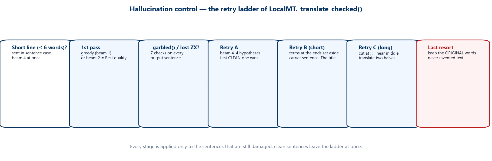</p>

**Code:** `LocalMT._garbled`, `_num_changed`, `_translate_checked`, `_in_carrier`, `translate_sentences`

A neural MT model is fluent even when it is wrong. Every output sentence goes through these tests:

| # | Test | Example it catches |
|---|---|---|
| 1 | empty or `U+FFFD` | decoding failure |
| 2 | copied source (≥ 60 % of the long English words present, no Persian letters, same first 30 characters) | model returns the English sentence |
| 3 | a word mixing Latin and Arabic letters | `اYOLOی` |
| 4 | Persian words in a Latin-script target | Persian → German output with Persian left in it |
| 5 | Latin words that are not in the source (non-Latin targets) | invented English words in Persian output |
| 6 | **numbers changed** (digits normalised first) | `27 January 2022` → `… 2018` |
| 7 | the same 2 words three times, or a 3–6-word phrase twice in a row | a stuck decoder |
| 8 | short line (≤ 5 words) inflated beyond 1.5 × + 2 words, or a new sentence appears inside it | `Examples` → *"Oh my God. Examples"* ([C-03](#c-03-oh-my-god-an-exclamation-invented-in-front-of-a-heading)) |
| 9 | output longer than 4 × source + 40 characters | run-away generation |
| + | a placeholder `ZXnXZ` is missing | the model dropped a term |

Damaged sentences climb the **retry ladder**: (A) beam 4, first clean hypothesis. (B) For a short line, the protected terms at both ends are set aside and only the words between them are translated; if that still fails, the words are translated inside a **carrier sentence**, *The title of this section is "…".*, and the quoted part is cut out. (C) For a long sentence that lost a part, it is cut at the `; : ,` nearest to the middle and the halves are translated separately. (D) If nothing passes, **the original words are kept**. A visible English sentence is better than a fluent invention.

Before any of this, `translate_sentences` strips **leading punctuation**. A sentence that starts with `. ` or `: ` (left over after a protected number or term) makes the model invent an exclamation in front of the translation.

### Stage 9 · Re-assembly and typography

**Code:** `assemble_item`, `persian_typography`, `rtl_bracket_fix`, `_post`, `proofread`

The translated text still contains `ZXnXZ`. Before any typographic rule runs, every placeholder is swapped for a **private-use character** (`U+E000 + k`). Regexes for quotes, commas or digits can't touch a sentinel, and a sentinel is one character, so spacing rules see a "word". Then:

* **Persian:** ي/ك → ی/ک, Arabic-Indic → Persian digits, Latin digits → Persian digits (option), `,` → `،`, `;` → `؛`, `?` → `؟`, "…" → «…», **ZWNJ** in `می‌` / `نمی‌` and before `ها/های`, no space before punctuation.
* **German:** „…“ quotes. **Latin targets:** Persian digits and punctuation of a Persian original → 0–9 and `, ; ?`.
* Then each sentinel is replaced by its piece: a fixed glossary translation, the inline-maths runs (re-typed one by one), a picture of the original, or the kept text in its **original font and size**. Placeholders the model lost are appended at the end of the item, so nothing is silently deleted.
* `proofread` counts restored terms, replaces empty results with the original and removes doubled words (`the the`).

### Stage 10 · Bidirectional text

**Code:** `Renderer._embed_latin`, `_marks_html`, `rtl_bracket_fix`, `_css_align`

Persian text with English terms, citations and maths is *bidirectional*. The Unicode Bidirectional Algorithm (UAX #9) reorders neutral characters (brackets, spaces, commas) by their neighbours. Without help, `(gradient) ∇f(x)` in a Persian sentence becomes `gradient) ∇f(x)(`. DeepTome:

* wraps every run of kept Latin pieces, including the neutral gaps between them (`Nathan Silberman, Pushmeet Kohli, Rob Fergus`, `[9, 10]`), in **one** left-to-right embedding `LRE … PDF` (U+202A / U+202C);
* puts an **RLM** (U+200F) outside every bracket of Persian text, so both brackets resolve to the paragraph direction and mirror as a pair;
* types the invisible marks **with the maths font**. Many Persian bold fonts have no glyph for them, and MuPDF drew `□` boxes in bold headings ([C-09](#c-09-boxes-in-bold-persian-headings));
* swaps `text-align` left/right for RTL paragraphs, because MuPDF's HTML engine counts from the start edge (`MUPDF_RTL_ALIGN_SWAPPED`).

### Stage 11 · Typesetting into the original page

**Code:** `render_pdf`, `Renderer.place`, `Renderer._rect_for`, `subset_font`, `make_oblique`, `swap_columns_pdf`

```python
# Author: Hadi Sarhangi Fard · Date: 2026-11-19 · render_pdf (excerpt): erase only the English glyphs
for p in todo:
    for bx in p.erase:                                  # EVERY span of the paragraph, not only one-line runs
        hh = bx[3] - bx[1]
        r = fitz.Rect(bx[0] + 0.3, bx[1] + 0.18 * hh, bx[2] - 0.3, bx[3] - 0.18 * hh)
        for z in keep_zones:                            # never cut into a displayed equation next to the text
            if r.intersects(z) and not fitz.Rect(p.bbox).contains(z):
                ...                                     # shrink the redaction away from the equation
        page.add_redact_annot(r, fill=False)
page.apply_redactions(images=fitz.PDF_REDACT_IMAGE_NONE, graphics=fitz.PDF_REDACT_LINE_ART_NONE)
```

1. **Erase.** Redaction annotations remove only the text glyphs of translated paragraphs. Images and line art stay (`PDF_REDACT_IMAGE_NONE`, `PDF_REDACT_LINE_ART_NONE`). Boxes are shrunk by 18 % of their height so that touching equations aren't clipped.
2. **Box.** The original paragraph box, allowed to grow **downward** into free space up to the next obstacle (translations are often longer). Single lines may also grow sideways. For a mirrored heading, the indentation is measured from the column's right edge.
3. **Typeset.** The pieces become HTML with per-piece CSS (font, size, weight, style, colour, sub/sup) and are set with `page.insert_htmlbox(rect, html, css, archive)`, MuPDF's HTML/CSS layout engine with complex-script shaping. If the text doesn't fit, the **whole paragraph** is scaled down step by step (*auto-shrink limit*, then 0.35 … 0.08) until it fits, and overflows are counted in the log.
4. **Fonts.** The chosen Persian fonts and the original fonts of the document (for kept terms) are **subset** with fontTools to the characters of the book. For Arabic script the **Arabic Presentation Forms** are kept, otherwise the PDF's text layer can't be read back ([C-01](#c-01-persian-output-had-an-unreadable-text-layer)). Persian has no italic, so an oblique face is synthesised (`make_oblique`, shear transform of the glyph outlines). A maths-capable Latin font (Cambria Math / STIX) is embedded for Greek, operators and the direction marks.
5. **Columns.** For Persian, every horizontal band of a two-column page has its halves exchanged (`swap_columns_pdf`, rebuilding the page from clipped copies of itself). Titles, figures and equations spanning both columns stay.
6. **Displayed equations, figures, tables** aren't touched at all: they remain the original vector objects.

### Stage 12 · Parts, cache and recovery

**Code:** `run_job`, `job_cache_dir`, `PENDING_FILE`, `send_eta`, `system_is_weak`

* A job is cut into **parts of 2 pages**. Each part is analysed, translated, proof-read, typeset and stored in `jobs/<hash>/`, and the output file is rebuilt after every part. The finished pages are therefore on disk even if the computer goes off.
* `pending_job.json` remembers a running job. After a restart the app offers to continue, and pressing RUN again continues after the last finished part.
* **Remaining time** = words still to translate × measured seconds per word of this job (pages differ a lot: a page of text versus a page of figures). History per engine and settings (`timing_history.json`) covers the first pages.
* **Weak computers** (≤ 4 physical cores or < 12 GB RAM) with > 20 pages: the PDF is written as **numbered 20-page files**, each complete as soon as its pages are done. Files over **700 pages** are refused.
* Output files that are open in another program are detected before the start (`is_locked`), and the result is saved with an index rather than lost.

## 13. LLM engines

**Code:** `LLMMT`, `llm_models`, `llm_base_url`

Ollama and online services are used through the **OpenAI chat-completions protocol** (`/v1/chat/completions`). `LLMMT` inherits the interface and the checks of `LocalMT`, with differences that suit LLMs:

* **System prompt** = translator role, source and target language, and five rules: copy every `ZXnXZ` exactly once at its place; add nothing; keep numbers, citations, units, names, code; formal textbook style; answer in the numbered format. The user's **Glossary** and **My instructions** follow (≤ 3 000 characters each).
* **Whole paragraphs, numbered** (`[1] … [2] …`) in reading order, batched up to 1 800 characters (Ollama) or 5 000 (online), so the model sees context. Answers are parsed back by number. `<think>…</think>` blocks of reasoning models are removed.
* `temperature = 0.1`. HTTP 401/403 → *key refused*; 404 → *model or address not found*; other errors → 3 retries with back-off.
* A damaged paragraph (lost placeholder, changed number, Persian left in a Latin target, absurd length) is asked again **alone**. If it is still damaged, the original text is kept.

## 14. Review editor internals

**Code:** `_review`, `apply_review_edit`, `_retext`, `_format_ranges`, `pushed_boxes`, `_snap_pushes`, `_push_page`, `apply_area_ops`

* The job process sends the part's PDF, the paragraph boxes (after any pushes), their texts and styles. The window renders the pages with PyMuPDF at the current zoom and draws a frame per block.
* **Changed words only.** `_retext` aligns the edited text with the original pieces, so formulas, kept terms and their fonts survive an edit. New words inherit the style of the text around them. `\n` becomes `<br>`, and several spaces become `&#160;`.
* **Word formats** are stored as character ranges `[start, end, scale, bold, italic]` and applied to the pieces by `_format_ranges`.
* **Inserting room** (a push `(y, dy, x0, x1)`). The page is **rebuilt from itself**: a new page shows the old page, a white rectangle covers the strip below `y`, and the strip is drawn again shifted by `dy` (`show_pdf_page(..., clip=strip)`). Everything stays vector-sharp, pictures included. A click inside a picture is moved above it (`_snap_pushes`). Paragraph boxes and obstacles move with the push (`pushed_boxes`).
* **Areas** are moved or erased with the same clip-and-redraw technique (`apply_area_ops`).

## 15. Quick translate and speech

* **One worker thread, two kinds of requests.** Typed text replaces the request that is still waiting (only the newest counts, and a sequence number stops an older answer from overwriting a newer one); sentences of Live translation are queued and all translated in order (`_quick_request`). The engine object stays loaded; `seq = -1` only loads it, which the window does as soon as it opens.
* **Voices.** `speak_to_file` picks the voice of the language chosen in Settings: **Piper** (VITS models exported to ONNX, run by onnxruntime, about 60 MB per voice, offline), **Edge** (Microsoft's neural voices through `edge-tts`, online, MP3) or the **Windows** WinRT `SpeechSynthesizer` (PowerShell script, WAV). Playback uses Windows MCI (`winmm.mciSendString`), which plays WAV and MP3 without extra packages and can be stopped at any moment.
* **Speech recognition.** `SpeechListener` has two threads. The capture thread reads 0.1 s blocks at 16 kHz (`soundcard`; the *loopback* device of the default speaker gives the sound of the computer) and cuts sentences with an energy detector whose threshold follows the noise floor: a pause of 0.6 s or 14 s of speech closes a sentence. The recognition thread turns each sentence into text with **faster-whisper** (CTranslate2 int8, the same runtime as the translator) and, while a sentence is still being spoken, re-transcribes the growing audio every 1.2 s for the live strip. Whisper's typical words on silence (*Thank you.*) are filtered.
* **Summary.** `compress_sentence` removes fillers per language (*um, you know, basically*; *äh, halt*; *euh, du coup*; *eh, o sea*; *خب، یعنی*), repeated words and side remarks in brackets or dashes before translation.

## 16. Installer

`installer/build_setup.py` builds `DeepTome_Setup.exe` with **IExpress**, from a WPF/PowerShell installer (`install.ps1`) with a branded header, three profiles (Advanced / Standard / Small), exact sizes, a free-space check, resumable downloads (`Get-File` with HTTP range requests), a private Python, `pip` packages, optional Ollama + model, desktop shortcut and uninstaller. The icon is generated in all sizes from one 1 220-px source. Windows caches shortcut icons aggressively, so each install copies the icon under a time-stamped name and refreshes the cache (`ie4uinit -show`).

---

# Part III: NLP laboratory (real measurements)

All numbers and figures in this part were produced on the author's laptop (4 physical cores, 16 GB RAM, no GPU) with the real MADLAD-400 3B weights: the int8 CTranslate2 engine that DeepTome uses, and the original float32 / bfloat16 checkpoint through transformers for the internals. The scripts are in [`examples/nlp_lab/`](examples/nlp_lab/).

## 17. Translations of one sentence

*"Distance estimation is an essential part of 3D scene recognition and orientation."*, greedy decoding, int8 engine:

| Target | Output | Time |
|---|---|---:|
| Persian | تخمین فاصله بخشی ضروری از تشخیص صحنه و جهت‌گیری سه بعدی است. | 3.8 s |
| German | Die Abstandsschätzung ist ein wesentlicher Bestandteil der 3D-Szenenerkennung und -Orientierung. | 5.1 s |
| French | L'estimation de la distance est une partie essentielle de la reconnaissance et de l'orientation de scènes 3D. | 5.5 s |
| Spanish | La estimación de distancia es una parte esencial del reconocimiento y la orientación de escenas 3D. | 4.8 s |

With placeholders (`ZX1XZ` = *Distance estimation*, `ZX2XZ` = *3D*):

| Target | Output |
|---|---|
| Persian | **ZX1XZ** بخشی ضروری از **ZX2XZ** تشخیص صحنه و جهت‌گیری است، که به دستگاه‌های خودگردان مختلف اجازه می‌دهد تا در محیط طبیعی حرکت کنند. |
| German | **ZX1XZ** ist ein wesentlicher Bestandteil der **ZX2XZ**-Szenenerkennung und -Orientierung, die es verschiedenen autonomen Geräten ermöglicht, … |

Both placeholders come back exactly once. German even builds a correct compound around one (`ZX2XZ-Szenenerkennung` → `3D-Szenenerkennung`).

Numbers: *"… published on 27 January 2022 and contains 7481 images."* → Persian `… در ۲۷ ژانویه ۲۰۲۲ منتشر شد و شامل ۷۴۸۱ تصویر است.` The model **converts the digits itself**, which is why the number test compares digits only after normalising Persian and Arabic-Indic digits to 0–9.

## 18. Token probabilities

<p align="center">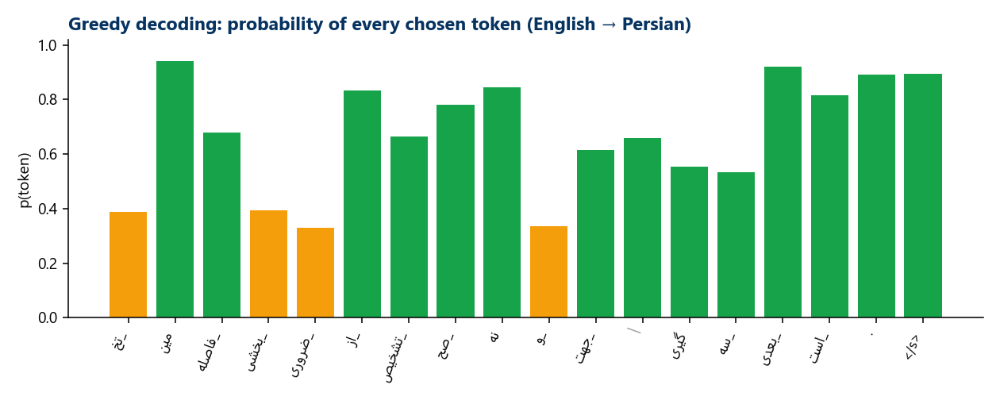</p>

The probability that the decoder gave each chosen token (`score_batch` of CTranslate2, after the fix in [C-17](#c-17-probabilities-flattened-by-a-hidden-132-output-scale)), English → Persian. Pieces that are forced by what came before are nearly certain: the second half of a word (`مین` after `▁تخ`, p = 0.94), the period, the end of sentence. The uncertain steps are **word choices**. The first word (`▁تخ`, 0.39) opens the sentence. `▁بخشی` (0.39) competes with `▁بخش`. `▁ضروری` (0.33) competes with near-synonyms such as *اساسی* and *مهم*. `▁و` (0.33) is a choice of word order. These are the steps where beam search (*Best quality*) can choose a different continuation.

The average log-probability of a whole translation is a useful, cheap warning signal: −0.20 … −0.45 for the correct sentences of [§ 17](#17-translations-of-one-sentence), −1.02 for the hallucinated heading and −1.30 for the hallucinated Persian → German sentence of [§ 22](#22-why-short-lines-are-dangerous). It doesn't separate every case (the correct `Funding` → `بودجه` scores −0.86), so DeepTome doesn't yet use it as a hard rule ([§ 24](#24-open-problems-and-limitations)).

## 19. Encoder self-attention

<p align="center">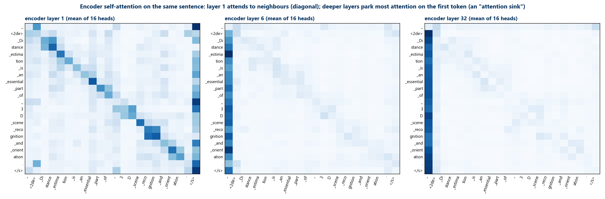</p>

Float32 encoder, the sentence above with the `<2de>` tag. **Layer 1** is local: each piece attends to itself and its neighbours (the diagonal), and pieces of one word (`▁reco` `gnition`) attend to each other. In deeper layers most heads put their weight on the first token. This *attention sink* is typical of large transformers: the token works as a "no-op" target, and the information sits in a few sharp heads rather than the mean.

## 20. Cross-attention: how a placeholder travels

<p align="center">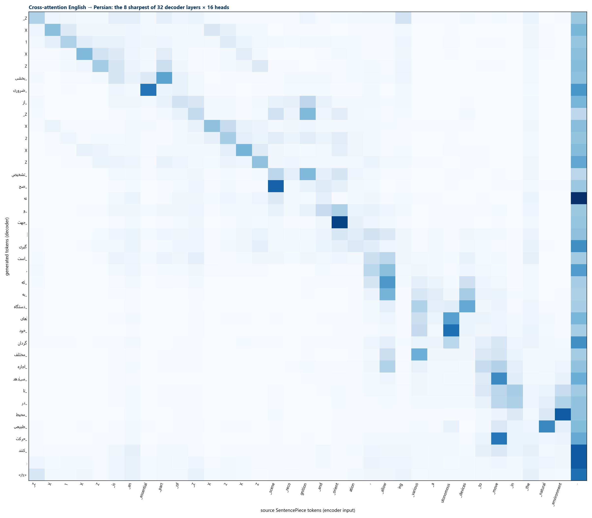</p>

Teacher-forced pass of the full model over the translation the int8 engine produced. Shown: the mean of the **8 sharpest of 32 decoder layers × 16 heads**, with the attention-sink columns (`▁`, `<2fa>`, `</s>`) removed and rows renormalised. The sharpest layers are 22–29 of 32 (selected by lowest attention entropy, the same for all four sentences). What the map shows:

* **Placeholders are copied, piece by piece.** While the decoder writes `▁Z X 1 X Z`, each output piece attends to the matching source piece (the small diagonal at the top left). The same happens for `ZX2XZ`. The protected term is never "understood", only copied.
* **Content words align one to one**: `ضروری` ↔ `essential`, `صح(نه)` ↔ `scene`, `جهت(گیری)` ↔ `orient`, `خودگردان` ↔ `autonomous`, `حرکت` ↔ `move`.
* **Reordering**: *natural environment* becomes `محیط طبیعی` (noun before adjective). `محیط` looks at `environment` first, then `طبیعی` looks back at `natural`, a crossing in the alignment.
* **Function words** (`از`, `که`, `به`, the verb `است`) spread their attention over the neighbourhood and the final period instead of one source token. They are produced by the target language model rather than translated.

<details>
<summary>German, and the sentences without placeholders</summary>

<p align="center">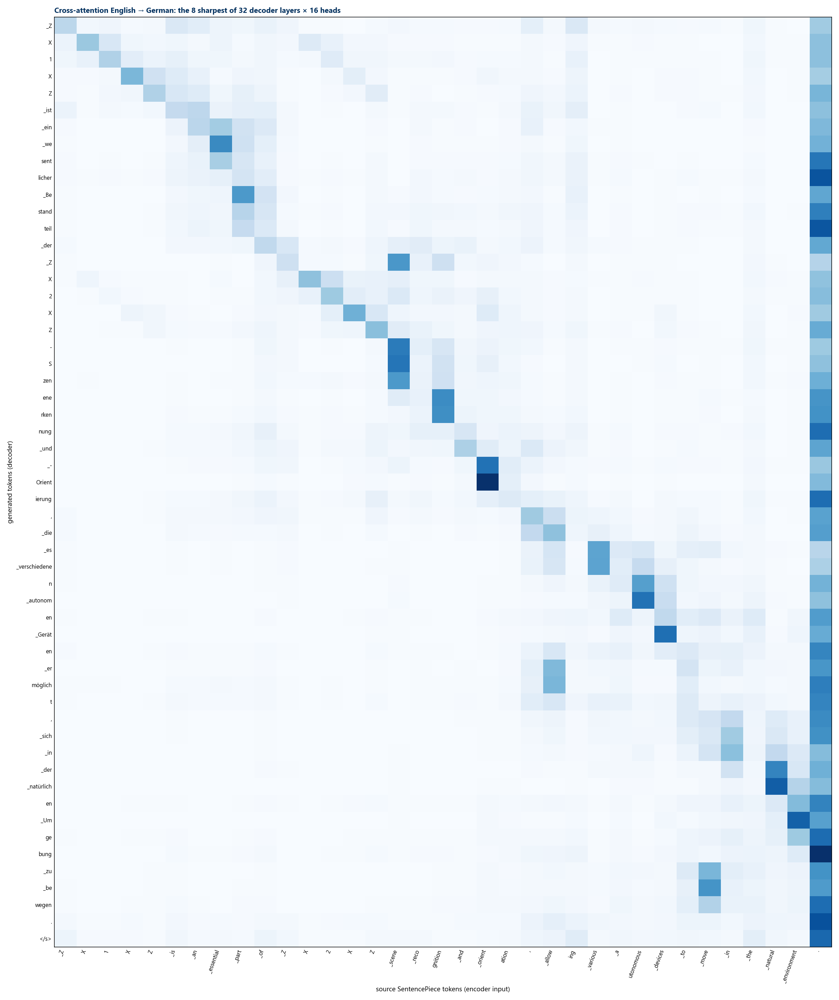</p>
<p align="center">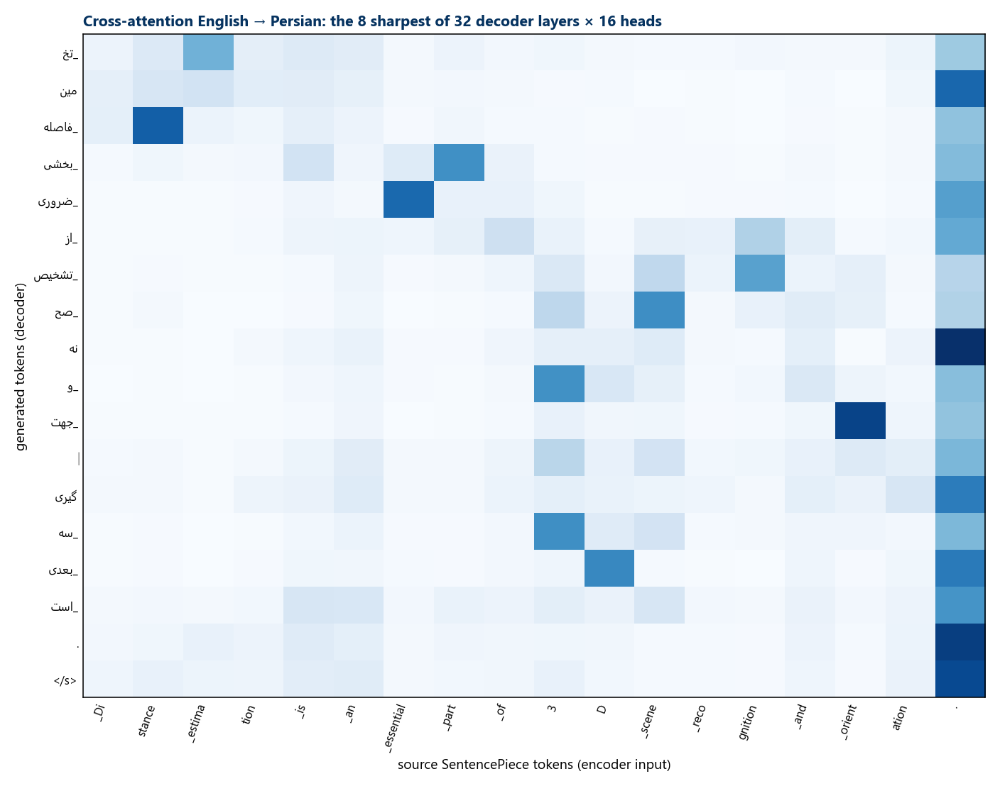 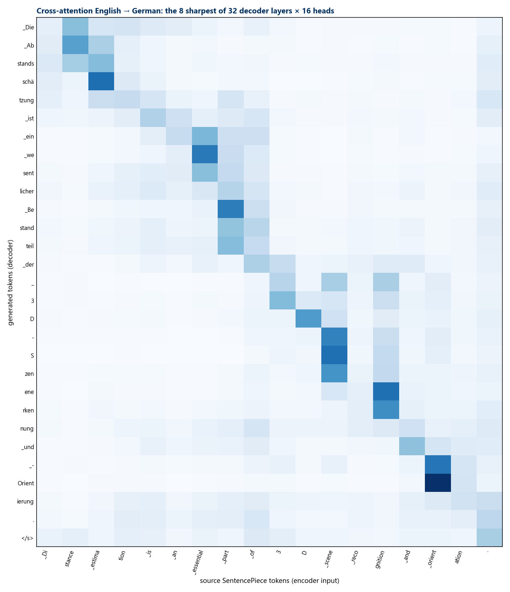</p>
</details>

## 21. The embedding space is language-independent

<p align="center">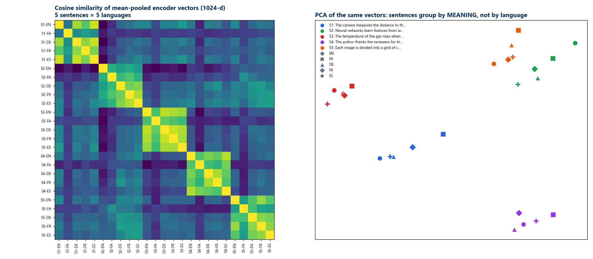</p>

Five English sentences and their translations into Persian, German, French and Spanish (made by the engine), each encoded by the float32 encoder and **mean-pooled to one 1024-d vector**. The average cosine similarity between versions of the **same** sentence in different languages is **0.854**, against **0.604** between **different** sentences. In the PCA projection the 25 points form five clusters by **meaning**, with the five languages inside each cluster. This shared space is why one model can translate between any two of its 419 languages, Persian → German included, without an English pivot.

<p align="center">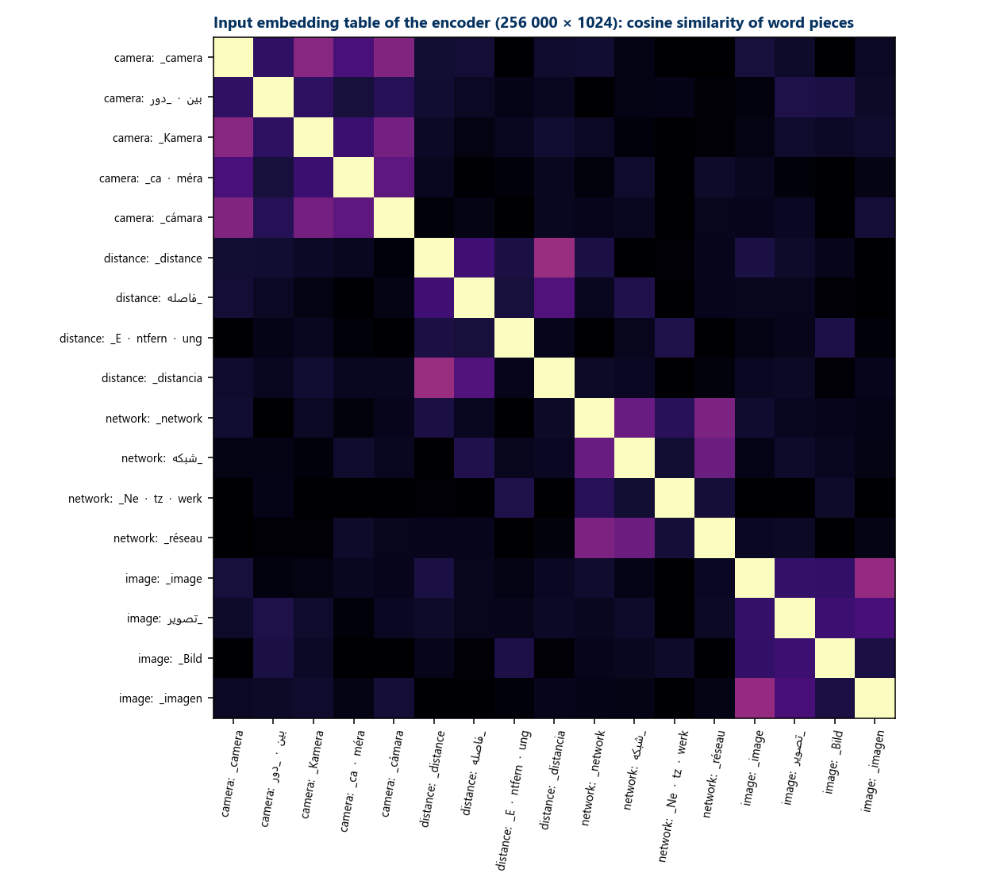</p>

The **input** embedding table tells a different story. Before any context is added, `camera`, `Kamera`, `cámara` and `caméra` are close because they share spelling, while `دوربین` (split into `▁دور` + `بین`, "far" + "see") is not. Meaning becomes language-independent **inside the encoder**, not in the vocabulary. (A practical detail found while measuring: the checkpoint stores the shared input table only once, as `decoder.embed_tokens.weight`. A loader that expects `encoder.embed_tokens` silently starts from random vectors.)

## 22. Why short lines are dangerous

Short lines, real outputs of the int8 engine (English → Persian):

| Input | Greedy | Beam 4 | In DeepTome |
|---|---|---|---|
| Funding | بودجه | بودجه | `حمایت مالی` (heading table) |
| Conflicts of Interest | تضاد منافع | تضاد منافع | `تعارض منافع` (table) |
| **Institutional Review Board Statement** | **وب‌گاه رسمی شرکت رایتل** — *"official website of the Rightel company"* | **وب‌گاه رسمی مؤسسه** — *"official website of the institute"* | `بیانیهٔ کمیتهٔ اخلاق` (table) |

A heading has no context. The model completes it with the most frequent pattern from its web training data (here, website footers of an Iranian mobile operator). Beam search makes the output less absurd but not right. Detection rules can't catch this case: the output is short, fluent Persian with no Latin letters and no numbers. This is the reason for the 110 + 65 **fixed standard headings**, for sending other short headings in sentence case, and for the carrier sentence in the retry ladder.

The other direction has the same weakness. Persian → German *"تخمین فاصله بخش مهمی از شناخت صحنهٔ سه‌بعدی است."* came back as *"Die Abbildung zeigt die dreidimensionale Darstellung der Szene."* ("The figure shows the three-dimensional representation of the scene"). It is fluent, but it is not the sentence. Directions without English are newer and less reliable ([§ 24](#24-open-problems-and-limitations)).

## 23. Speed

| Decoding | Sentences | Source tokens | Output tokens | Time | Tokens/s |
|---|---:|---:|---:|---:|---:|
| Greedy (default) | 31 | 1 213 | 1 183 | 140 s | **8.4** |
| Beam 2 (Best quality) | 31 | 1 213 | 1 183 | 233 s | **5.1** |

One dense page of a scientific article takes about 2–3 minutes on this laptop with the default settings. A GPU (CTranslate2 `device="auto"` picks it up) or a smaller model (NLLB-200 600M) is many times faster.

---

# Part IV: Challenge log

The real problems met while building DeepTome, with the root cause found and the fix in the code. Most of them were invisible in tests on clean text and only appeared on real journal PDFs.

<details open>
<summary><b>Before / after</b>: the same page with version 3.1 (16 Nov) and 3.4</summary>

| Version 3.1 | Version 3.4 |
|---|---|
| 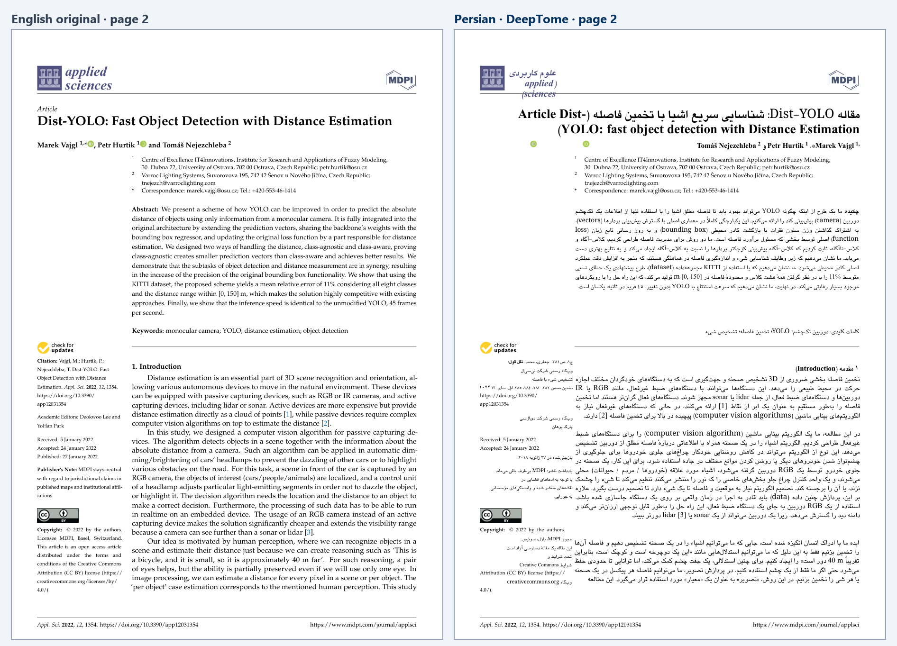 | 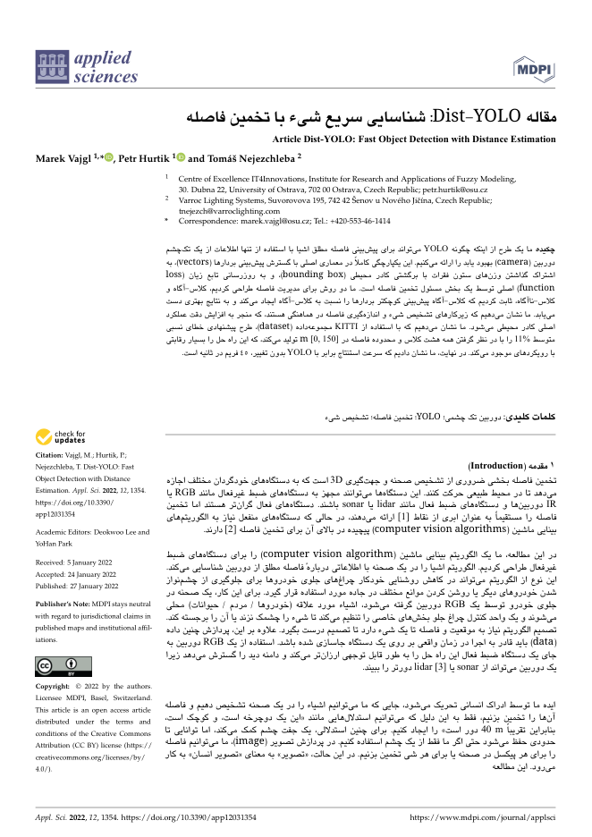 |
| The margin note (citation box) was translated and the model **invented a Persian citation** (*"ج۱، ص۳۸۱، جعفری، محمد"*). The journal name in the logo was translated. The text layer is unreadable. | Margin notes, logo text and names are kept. The title has its original under it. The text layer can be copied and searched. |
</details>

#### C-01. Persian output had an unreadable text layer
*Symptom:* Persian PDFs written by DeepTome looked right, but copying text gave `\x9e¤8د \x99¦`. The same files, given back to DeepTome, were detected as **Spanish**. *Cause:* MuPDF draws Arabic script with the contextual glyphs of the font, whose code points are the **Arabic Presentation Forms** (U+FB50–FDFF, U+FE70–FEFE). The font subsetter kept only the characters of the text (base letters), so the PDF's ToUnicode map pointed at glyphs that had no code point any more. *Fix:* `subset_font` always keeps both presentation-form blocks when the text contains Arabic script. On input, `_fix_lig` normalises presentation forms back to base letters with NFKC. `text_damage` + Persian-font evidence now detect such files and warn.

#### C-02. Invented names and a fake citation in the margin
*Symptom:* author lines and the citation box in the page margin came back with famous Persian names (e.g. *Ali Akbar Dehkhoda*) and an invented book reference. *Cause:* names and bibliographic fragments are out of distribution for a sentence model, which "normalises" them to the most frequent names it knows. *Fix:* `names_line` (a grammar of name tokens, affiliation marks `1,*`, `Dr.`, `and`/`und`) and margin-note detection: such blocks never reach the model.

#### C-03. "Oh my God": an exclamation invented in front of a heading
*Symptom:* `Examples` became *«اوه خدای من. مثال‌ها»*. *Cause:* after a protected section number, the text sent was `. Examples`. A sentence starting with punctuation looks like the continuation of dialogue to the model. *Fix:* leading punctuation is stripped before translation and put back afterwards (`translate_sentences`). Short lines go in sentence case with beam 4, and test 8 rejects inflated short outputs.

#### C-04. Title Case invents list titles
`Institutional Review Board Statement` in Title Case made the model answer with invented menu titles. *Fix:* `sentence_case` for short lines, plus the fixed heading tables ([§ 22](#22-why-short-lines-are-dangerous)).

#### C-05. German fraction bar left behind
*Symptom:* in a German translation, the letters of an inline fraction moved with the text but its bar stayed at the old place. *Cause:* the bar is a **drawn line**, not a character, and redaction leaves line art alone on purpose. *Fix:* `mark_fractions` finds thin drawn bars inside sentences, copies the whole expression (with the `Z =` in front of it) as one picture, and erases the bar.

#### C-06. "Best quality" looked reversed
Ticking *Best quality* sometimes gave the **same** result faster. *Cause:* the beam-search job reused the cache of the greedy job. *Fix:* a separate cache file (`_bq`) per decoding mode.

#### C-07. Greek letters printed as Korean syllables
Some PDFs store maths italic letters (U+1D400–1D7FF, outside the BMP) in a broken character table that drops the high part, so `𝜃` arrives as U+D703, a Hangul syllable. *Fix:* `_fix_lig` maps U+D400–D7CB back to `chr(0x10000 + code)` and normalises with NFKC (`𝜃` → `θ`).

#### C-08. Hidden control characters
Springer puts a **BEL** (U+0007) between a heading number and its title, and it was typeset as a `�` box. TeX's `CMEX` fonts have no Unicode map for big operators (`P` = ∑, `R` = ∫). *Fix:* control characters are removed (`_CTRL_RE`), and CMEX letters are mapped (`_CMEX_MAP`).

#### C-09. Boxes in bold Persian headings
The invisible direction marks LRE/PDF/RLM were drawn as `□` in bold headings. *Cause:* the bold face of the Persian font had no glyph for them, while the regular face had. *Fix:* `font_has_marks` tests **every** face, and the marks are typed in the maths font, which owns these glyphs.

#### C-10. Align Right came out left
MuPDF's HTML engine counts `left`/`right` from the start edge in an RTL paragraph, so *Align Right* appeared at the left. *Fix:* `_css_align` swaps the two for RTL paragraphs (`MUPDF_RTL_ALIGN_SWAPPED`).

#### C-11. English lines left under the translation
The first renderer erased only the boxes of style runs. A run that continues on the next line has no box, so lines of English stayed under the Persian text. *Fix:* every paragraph keeps the box of **every span** (`Para.erase`), and only those are redacted.

#### C-12. Equations clipped by neighbouring redactions
A redaction box of a text line overlapped the top of a displayed equation below it. *Fix:* redaction boxes are shrunk by 18 % of their height and kept out of `formula-like` zones (`keep_zones`).

#### C-13. The workload chart lagged one page behind; the ETA was wrong
*Cause:* progress was counted in pages, but pages differ by a factor of 10 in text. *Fix:* both are now computed from **words** (`page_words`, seconds per word measured in the job).

#### C-14. Hyper-threads made it slower
8 threads on a 4-core CPU were 25 % slower than 4. *Fix:* `physical_cores()` (psutil, or WMI through PowerShell).

#### C-15. Token count off by a third
The window assumed 1.35 tokens per word. Measured with the real tokenizer on three articles: 1.99–2.15. *Fix:* exact counting with SentencePiece (2 s) when the model is installed, otherwise 2.0.

#### C-16. Converted model without its SentencePiece file
With transformers 5, `save_pretrained` writes only `tokenizer.json`. After a normal installation the downloaded folder is deleted, so the exact token count fell back to the estimate. *Fix (found while writing this README):* `prepare_model` copies `spiece.model` into the converted folder.

#### C-17. Probabilities flattened by a hidden 1/32 output scale
*Symptom (found while measuring for this README):* the translations of the int8 engine were correct, but **every** token had a log-probability of about −12, almost uniform over 256 000 pieces (ln 256 000 = 12.45). *Cause:* MADLAD-400 has separate input and output embeddings (`config.json`: `"tie_word_embeddings": false`), but transformers 5 reports them as tied. CTranslate2's T5 converter then sets `decoder.scale_outputs = d_model ** -0.5 = 1/32`, the scale T5 needs for **tied** embeddings. Dividing logits by 32 keeps the arg-max, so greedy output doesn't change. But the softmax becomes flat, and beam search (*Best quality*) and the ranking of hypotheses in the retry ladder then work on distorted scores. *Fix:* `_untie_t5_output_scale` reads the model's own `config.json` and removes the scale during conversion. The model was re-converted, and the figure in [§ 18](#18-token-probabilities) uses the corrected engine.

#### C-18. The reverse direction (Persian → English)
*Found by translating a DeepTome output back into English for this README.* (1) Persian digits inside protected maths units and citations stayed Persian in the English text (`[۰, ۱۵۰] m`, `[۱]`). The digit normalisation ran on text and kept terms, but not on the original runs of an inline maths unit. The characters in the Persian file were in fact ASCII (`11%`, `[0, 150]`). They looked Persian because kept terms are typeset in their **original font**, and Persian *B*-series fonts (B Yagut, B Nazanin …) draw 0–9 as Persian digits and map them to Persian code points in the text layer. *Fix:* for a Latin-script target the renderer never uses a Persian original font (`_RTL_FONT_RE`); kept terms get a Latin face. Digits inside maths runs and glossary pieces are also normalised (`assemble_item`). (2) The heading «چکیده» (*Abstract*) came back as *"It's stuck."* and «کلمات کلیدی» as *"My keywords"*: the standard-heading tables were written English → X and were never consulted for a Persian or German original. *Fix:* `fixed_heading` reads a table backwards (`چکیده` → `abstract`, with aliases such as `کلمات کلیدی`) and then forwards into the target language (`Abstract`, `Zusammenfassung`). Both fixes are visible in [§ 2.4](#24-persian--english-the-mirror-direction).

#### C-19. Windows-specific problems
* 8.3 short paths and paths over 260 characters → `long_path`, `fit_output_path`, `\\?\` prefixes.
* An output file open in a viewer can't be overwritten → detected before the start; saved with an index.
* Desktop icon not refreshed after an update → time-stamped icon file + `ie4uinit -show`.
* The model download through Hugging Face symlinks fails without admin rights → `snapshot_download(local_dir=…)` into a normal folder, with a completion marker.

#### C-20. Tk has no bidirectional text input
*Symptom (reported by the author):* typing Persian in Quick translate put the cursor at the start of the line and the last letter of the last word at the beginning; in the review editor the words *moved with the cursor* when the arrow keys were used. *Cause:* Tk 8.6 does not implement the Unicode bidi algorithm for its `Text` and `Entry` widgets. A line is cut into display chunks at the insertion cursor, and Windows mirrors each chunk separately, so the visual order changes whenever the cursor moves. *Fix:* `BidiText`, a native **RichEdit 5.0** control (`Msftedit.dll`, the editor of WordPad) created with `CreateWindowExW` as a child of a Tk frame. The text is read with `EM_GETTEXTEX` (paragraph ends count as one character, so offsets match), right-to-left paragraphs are set with `PARAFORMAT2` (`PFE_RTLPARA`, right alignment), formats of selected words with `CHARFORMAT2`, keys such as Enter / Esc / Ctrl+Enter are caught by sub-classing the window procedure, and changes are noticed by polling every 120 ms. All boxes where Persian is typed use it: Quick translate, the review editor, Glossary and My instructions.

#### C-21. Two minutes lost in `import transformers`
*Symptom:* the first Quick translation took about 3 minutes, and every job spent the same time before its first page. *Measurement:* `import transformers` alone took **111 s** on the author's PC; loading the int8 model took 9–39 s, a sentence 3 s. Transformers was only used for the T5 tokenizer. *Fix:* `_SpmTok` reads `spiece.model` with `sentencepiece` (0.1 s) and reproduces the transformers T5 tokenizer exactly: T5 collapses every run of white space before SentencePiece (verified on English, Persian, German, French and Spanish sentences, placeholders, tabs and no-break spaces: identical token ids and identical decoded text). NLLB still uses transformers.

#### C-22. Live preview without losing exactness
A page editor that waits for *Save* is hard to use, but typesetting a part takes seconds. *Solution:* two layers. (1) The window shows a move **at once** by cutting the moved region out of the rendered page picture (`PhotoImage.copy -from`) and drawing it at the new place over a white patch. (2) After the change, the whole state of the window (edits, frames, spaces) is sent as one JSON object. The job compares it with the state it rendered last; if it differs, it restores the `pristine` snapshot of every paragraph (box, size, styles, a deep copy of its pieces) and applies the state from the start. Repeated or overlapping updates can therefore never add up, and only one update is in flight at a time (a newer change waits and is sent when the page has arrived).

---

## 24. Open problems and limitations

Known weak points, stated openly:

1. **Placeholder boundaries in dense maths.** The real abstract of *Dist-YOLO* page 6 still produces splits such as `Dist-ZX1XZ` (a protected *YOLO* inside a hyphenated name), `ZX3XZ(·, ZX4XZ` (the function `H(·, ·)` cut at its comma), `ˆZX1XZ` (a combining hat left outside the unit) and `ZX7XZ, 1ZX8XZ` for `qi,j ∈ {0, 1}`. The output is still correct when the model keeps the pieces in order, but it relies on the model.
2. **Hallucinations that look fluent.** [§ 22](#22-why-short-lines-are-dangerous) shows outputs that pass every rule-based test. Only tables, sentence casing and context reduce them; a learned quality-estimation model (e.g. COMET-QE) would be the next step.
3. **Directions without English** (Persian ↔ German/French/Spanish) are clearly weaker than English ↔ X, and some of DeepTome's helpers (English heading table, carrier sentence) are English-only.
4. **Speed on CPUs.** About 8 tokens/s on 4 cores: a 300-page book takes many hours. GPUs, NLLB-600M or an LLM API are the alternatives.
5. **Heuristic layout analysis.** Unusual layouts (three columns, text wrapped around figures, tables without lines) can be misclassified. The review editor is the safety net.
6. **Scanned PDFs** need OCR first. PDFs with broken character tables can't be translated (and are now detected).
7. **Word output** exists in the code but is disabled until it reaches PDF quality.
8. **Speech**: the offline voices and speech recognition are separate downloads (≈ 300 MB voices, 485 MB for the recommended Whisper model). On a 4-core CPU Live translation follows the speaker with a delay of a few seconds per sentence (recognition + translation); the *small* Whisper model recognises Persian less reliably than English.
9. **Memory for the one-time conversion**: ≈ 16 GB RAM.
10. **Licences**: NLLB-200 is CC-BY-NC (non-commercial). PyMuPDF is AGPL-3.0 or commercial, which matters for a closed-source distribution.
11. **Article-type labels and heading tables.** Spanish and French have no fixed heading table yet (`Abstract:` can stay English in Spanish). **Article-type labels in titles:** On the MDPI template the small label *Article* above the title is merged into the title, so the translation starts with `مقاله` and the original under it reads *Article Dist-YOLO: …* (visible in [§ 2.2](#22-original-and-translation-page-by-page)).
12. **Subtitles**: a sentence shared over several cues is split by length, so a word can land one cue early or late when the translation reorders the clauses.
13. **No confidence score is used yet.** The average log-probability separates several hallucinations from correct outputs ([§ 18](#18-token-probabilities)), but not all of them. It still needs calibration before it can trigger retries.

## 25. Performance

| Measurement | Value |
|---|---|
| Layout analysis | < 1 s per page |
| Translation, built-in engine, 4-core CPU | 8.4 tokens/s (≈ 2–3 min per dense page), Best quality 5.1 tokens/s |
| Engine load | 8.6 s (int8, 2.77 GB) |
| One-time model conversion | 397 s, ≈ 16 GB RAM |
| Language detection + token count of a 14-page article | ≈ 2 s |
| Cache hit | a sentence is never translated twice for the same engine and target |

## 26. Project structure

```text
DeepTome-Translator/
├── book_translator.py          the application: pipeline, engines, GUI, CLI      (≈10 700 lines)
├── requirements.txt            Python packages
├── assets/                     logo, icon (all sizes), header images
├── installer/
│   ├── build_setup.py          builds DeepTome_Setup.exe (IExpress), icons, the GitHub folder
│   ├── install.ps1             WPF setup: profiles, sizes, resumable downloads, shortcuts
│   ├── uninstall.ps1
│   └── docs/                   README / LICENSE / third-party notices / changelog for the installed app
├── examples/
│   ├── tokenize_demo.py        segmentation → protection → SentencePiece → language tag (optional --translate)
│   └── nlp_lab/                the scripts behind Part III: engine measurements, encoder vectors,
│                               cross-attention of all layers, figures
├── docs/images/                every picture of this README
├── CHANGELOG.md · LICENSE · README_fa.md
```

Every code file starts with a header that gives author, date and purpose, for example:

```python
# Author: Hadi Sarhangi Fard
# Date:   2026-11-19
# File:   examples/tokenize_demo.py - shows how DeepTome turns a sentence into model input
```

`book_translator.py` reads top-down in the order of the pipeline: fonts → options → layout analysis → classification → terms → placeholders → typography → engines → hallucination control → rendering → exports → job control (`run_job`) → help texts → GUI (`run_gui`) → CLI (`run_cli`).

## 27. Roadmap

* Quality estimation (COMET-QE style) to catch fluent hallucinations.
* Word (.docx) export at PDF quality.
* GPU build of the installer; NLLB / MADLAD successors as they appear.
* OCR integration for scanned books.
* A learned layout model (e.g. DocLayNet-trained detector) as a second opinion for the heuristics.
* More languages in the window (the pipeline already knows Arabic, Urdu, Chinese, Hindi, Bengali, Portuguese, Russian, Indonesian).

## 28. References

1. Kudugunta et al., *MADLAD-400: A Multilingual and Document-Level Large Audited Dataset*, NeurIPS 2023, arXiv:2309.04662.
2. NLLB Team, *No Language Left Behind: Scaling Human-Centered Machine Translation*, arXiv:2207.04672.
3. Raffel et al., *Exploring the Limits of Transfer Learning with a Unified Text-to-Text Transformer* (T5), JMLR 2020, arXiv:1910.10683.
4. Vaswani et al., *Attention Is All You Need*, NeurIPS 2017, arXiv:1706.03762.
5. Kudo & Richardson, *SentencePiece: A simple and language independent subword tokenizer*, EMNLP 2018, arXiv:1808.06226.
6. Kudo, *Subword Regularization* (the unigram language model), ACL 2018, arXiv:1804.10959.
7. Shaw, Uszkoreit, Vaswani, *Self-Attention with Relative Position Representations*, NAACL 2018, arXiv:1803.02155.
8. Xiao et al., *Efficient Streaming Language Models with Attention Sinks*, ICLR 2024, arXiv:2309.17453.
9. Klein et al., *CTranslate2*, OpenNMT, https://github.com/OpenNMT/CTranslate2.
10. Unicode Standard Annex #9, *Unicode Bidirectional Algorithm*.
11. PyMuPDF, https://pymupdf.readthedocs.io.
12. Vajgl, Hurtik, Nejezchleba, *Dist-YOLO: Fast Object Detection with Distance Estimation*, Applied Sciences 2022, 12, 1354 (CC BY 4.0), the demonstration document.

```bibtex
@software{sarhangifard2026deeptome,
  author = {Sarhangi Fard, Hadi},
  title  = {DeepTome Translator: layout-preserving neural machine translation of PDF documents},
  year   = {2026},
  version = {3.4},
  url    = {https://github.com/Hadifard}
}
```

## 29. Licence and contact

© 2026 Hadi Sarhangi Fard. All rights reserved. The source is published for reading and evaluation. Use, redistribution or commercial licensing require the author's written permission. Third-party components keep their own licences (see `installer/docs/THIRD_PARTY_NOTICES.txt`). PyMuPDF is AGPL-3.0, and the NLLB-200 models are CC-BY-NC.

**Author:** Hadi Sarhangi Fard. For licensing, cooperation or a demonstration:

* GitHub: https://github.com/Hadifard
* LinkedIn: https://www.linkedin.com/in/hadi-sarhangi-fard-mech-eng/
