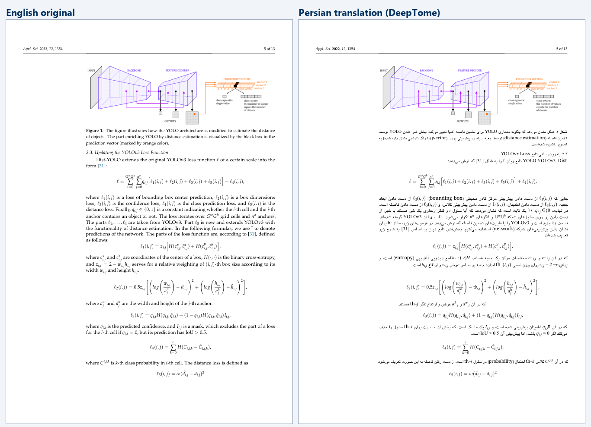
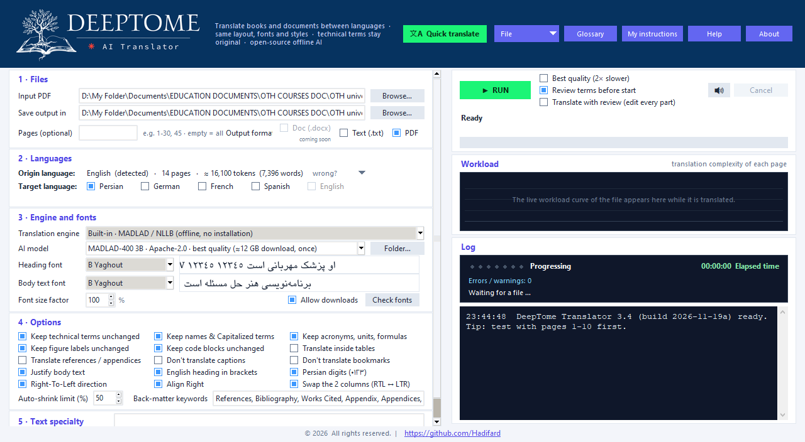
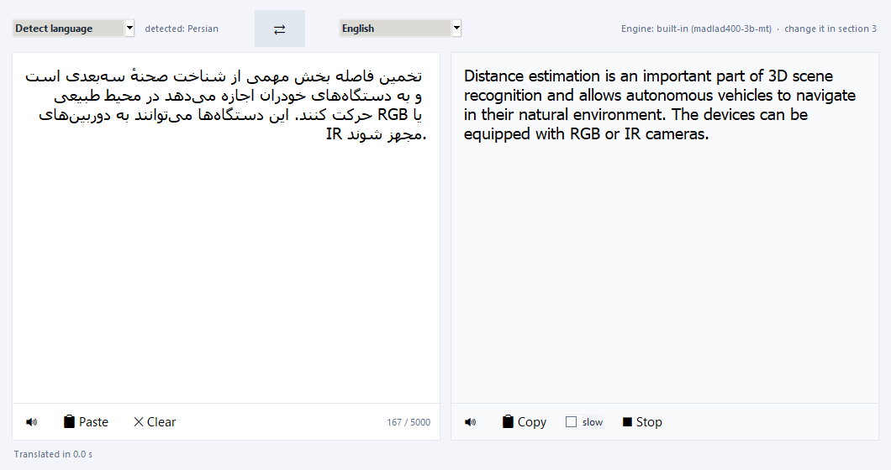
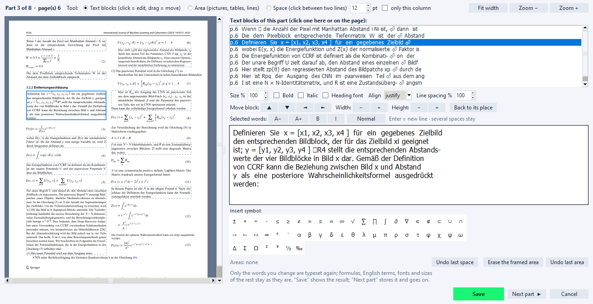
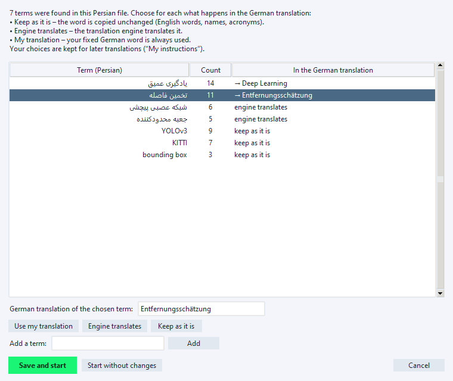
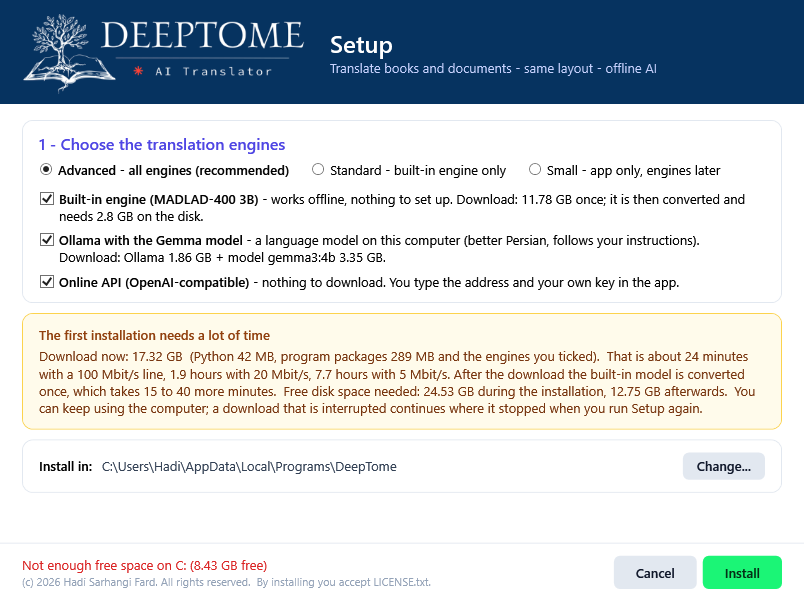

<!--
  File    : README.md
  Author  : Hadi Sarhangi Fard
  Date    : 2026-11-19   (DeepTome Translator 3.4)
  Purpose : Project page on GitHub - what the software does, how its NLP pipeline works, how to install and use it.
-->

<p align="center">
  
</p>

<h3 align="center">Layout-preserving neural machine translation of PDF books and scientific articles</h3>

<p align="center">
  
  
  
  
  
  
</p>

<p align="center">
  <b>English · Persian · German · French · Spanish</b> - in both directions - on your own computer, with the page
  layout, the formulas, the figures and the tables kept exactly where they were.
</p>

<p align="center"><a href="README_fa.md">فارسی</a></p>

---

## Contents

- [What DeepTome does](#what-deeptome-does)
- [See it](#see-it)
- [Strengths of the project](#strengths-of-the-project)
- [What you can do with it](#what-you-can-do-with-it)
- [How it works - the NLP pipeline](#how-it-works---the-nlp-pipeline)
- [Tokenization - how the text becomes model input](#tokenization---how-the-text-becomes-model-input)
- [Translation engines](#translation-engines)
- [Installation](#installation)
- [Usage](#usage)
- [Project structure](#project-structure)
- [Performance](#performance)
- [Limitations](#limitations)
- [References](#references)
- [License](#license)
- [Author](#author)

---

## What DeepTome does

Machine translation services translate **text**. A scientific PDF is more than text: it has two columns, displayed
equations, inline maths such as `σ ∈ [0, 1]`, figures with labels, tables, captions, footnotes, running heads,
references and technical terms that must not be translated.

DeepTome reads the **layout** of every page, translates only the running text with a neural machine translation
model, and writes the translation back **at the place of the original paragraph** - with its size, weight, colour,
alignment and line spacing. Everything that is not running text stays untouched in vector quality. For
right-to-left languages (Persian) the page is mirrored: text runs right to left, two-column pages swap their
columns, and English terms inside Persian sentences keep their own direction.

The default engine is **MADLAD-400 3B**, an open multilingual transformer that runs **offline** on an ordinary CPU.
Two more engines are optional: **Ollama** (local large language models such as Gemma or Qwen) and **any
OpenAI-compatible online API** with your own key.

---

## See it

### One page of a scientific article - English original and Persian translation

<p align="center">
  
</p>

<sub>Page 6 of *Dist-YOLO: Fast Object Detection with Distance Estimation* (M. Vajgl, P. Hurtik, T. Nejezchleba,
Applied Sciences 2022, 12, 1354, licensed CC BY 4.0), translated by DeepTome with the built-in MADLAD-400 model.
The figure, all displayed equations, the inline symbols and the citations are the original vector content;
technical terms are kept in English in brackets.</sub>

### The application

| Main window | Quick translate (with pronunciation) |
|:---:|:---:|
|  |  |
| **Review & layout editor** | **Technical terms of a Persian file → German** |
|  |  |
| **Illustrated help in five languages** | **One-click Windows setup** |
|  |  |

<sub>The quick-translate picture shows a sentence pair that the built-in model produced in a test
(Persian → English).</sub>

---

## Strengths of the project

| | |
|---|---|
| 📐 **Layout is preserved** | Every paragraph returns to its own position with its font size, bold / italic, colour, alignment and line spacing. Figures, tables, displayed equations and lines are never re-drawn - they stay the original vector objects. |
| ∑ **Mathematics survives translation** | Displayed equations are detected and left untouched. Inline maths (`d_i = f·H/h`, `σ ∈ [0, 1]`, sub- and superscripts) is clustered into one protected unit that moves with its sentence; fractions inside a sentence are copied as one piece of the original. |
| 🔒 **Terminology protection** | Acronyms, units, identifiers, names of persons and technical terms are masked as placeholders before translation, so the model can neither translate nor damage them. A glossary and free "My instructions" let the user decide per term. |
| 🛡️ **Hallucination control** | Every output sentence is checked: copied source, mixed scripts, invented words, changed numbers, repeated phrases, absurd length, lost placeholders. Damaged sentences are translated again with a wider beam, inside a carrier sentence or in two halves - and if all fails, the original is kept rather than invented text. |
| 🌍 **Five languages, both directions** | English, Persian, German, French, Spanish. The origin language is **detected automatically**; everything done for English → Persian is done the other way round for Persian → English (direction, alignment, columns, digits). |
| 🔤 **Real right-to-left typesetting** | Persian typography (Persian letters and digits, half-spaces in `می‌` and `‌ها`, «guillemets»), Unicode bidirectional marks around brackets and Latin runs, mirrored alignment and swapped columns. Output PDFs keep a **readable, searchable text layer**. |
| 💻 **Offline and private** | The built-in engine runs on the CPU of your computer. No account, no key, no upload. An online engine is only used if you choose it. |
| 🧠 **Three engines, one pipeline** | MADLAD-400 / NLLB-200 (CTranslate2, int8), Ollama (Gemma, Qwen …) or any OpenAI-compatible API. With LLM engines the glossary and the user's instructions are written into the prompt and whole paragraphs are translated in context. |
| ♻️ **Robust for long books** | The work is done in parts of two pages; every finished part is cached, the output file grows after each part, and an interrupted job continues where it stopped - even after a power cut. Long jobs on slow computers are saved as numbered 20-page files. |
| ✍️ **Review and layout editor** | After each part you can click a block on the page and change only the words you want; Enter makes a new line; select words to change their size or weight; change line spacing and block height (content below moves along); insert or remove room between lines; move or erase pictures and tables; insert maths symbols. |
| ⚡ **Quick translate** | A Google-Translate-like window for typed or pasted text, with automatic language detection, swap, copy and **pronunciation** through the voices of Windows. |
| 📊 **Transparent progress** | Live log, a "heart-monitor" chart of the translation complexity of every page region, page / part / status line, and a remaining-time estimate computed from the amount of text (words), not from page counts. |
| 📦 **Ready for non-programmers** | A one-file Windows setup installs a private Python, the packages and the engines (with exact download sizes shown first), creates a desktop shortcut and an uninstaller. |

---

## What you can do with it

- **Read research in your language** - translate an article or a whole textbook into Persian, German, French or
  Spanish and keep its equations and figures readable.
- **Publish in another language** - translate your own Persian paper into English (or German, French, Spanish) as
  a first draft that already has the right layout.
- **Study with both languages** - headings keep the English original in brackets, and the title of the document is
  printed with its original underneath.
- **Teach the system your terminology** - fix how a term is translated ("loss" → «زیان»), or keep it unchanged;
  the rules are remembered for every later translation.
- **Correct before saving** - review every two-page part, fix words, sizes, line breaks and spacing, move pictures.
- **Translate short texts at once** - e-mails, abstracts, captions - and listen to the pronunciation.
- **Process long books unattended** - up to 700 pages; the job survives restarts and saves as it goes.
- **Export plain text** - a `.txt` file of the translation in reading order, for corpora, alignment or further NLP.
- **Use it as a library** - the pipeline functions (`split_sentences`, `Protector`, `LocalMT`, `render_pdf` …) can be
  imported from `book_translator.py`; see [`examples/tokenize_demo.py`](examples/tokenize_demo.py).

---

## How it works - the NLP pipeline

```mermaid
flowchart LR
    A[PDF] --> B[Layout analysis<br/>spans → lines → paragraphs]
    B --> C[Classification<br/>headings · formulas · figures<br/>tables · margin notes · names]
    C --> D[Language<br/>identification]
    D --> E[Sentence<br/>segmentation]
    E --> F[Protection<br/>placeholders ZXnXZ<br/>glossary · instructions]
    F --> G[Subword<br/>tokenization<br/>SentencePiece]
    G --> H[Neural MT<br/>MADLAD-400 · NLLB-200<br/>Ollama · API]
    H --> I[Quality control<br/>hallucination checks<br/>re-translation]
    I --> J[Restore placeholders<br/>typography · bidi]
    J --> K[Typesetting<br/>original position & style]
    K --> L[PDF · TXT]
```



### 1. Document layout analysis
PyMuPDF returns every text **span** with its font, size, flags, colour and bounding box. DeepTome joins spans to
lines and lines to paragraphs with geometric rules (line pitch, indentation, justified right edge, same-row joins
for run-in headings), and classifies every block:

| Class | Evidence |
|---|---|
| displayed formula | maths fonts (CMMI, CMSY …), operator density, few long words, equation number `(3)` |
| inline maths | maths font, single italic letters, Greek letters, sub- / superscript runs, operators between them |
| heading / title | size relative to the body text, weight, length, numbering; multi-line titles are merged |
| figure / chart label | short text inside a cluster of vector drawings or next to axis tick numbers |
| table | `find_tables` plus text-grid detection |
| margin note | outside the x-range of the text column(s) |
| names of persons | author / editor lines (`Edited by Dr. …`, affiliation marks `1,*`) |
| running head, page number, URL, front / back matter | repetition on several pages, position, patterns |

Only running text is translated; everything else is kept.

### 2. Language identification
Script detection (Arabic-script letters including the Presentation Forms, Persian-only letters `پ چ ژ گ ک ی`) and
function-word profiles for English, German, French and Spanish. A **text-damage score** (share of control,
private-use and replacement characters) detects PDFs whose fonts have no correct character table - such text can
not be translated and is reported instead of being guessed.

### 3. Sentence segmentation
NMT models are trained on sentences. The splitter cuts at `. ! ? ؟` followed by an upper-case letter, a digit or a
placeholder, and re-joins false splits after abbreviations (`Fig.`, `Eq.`, `e.g.`, `et al.`, single capital
initials). Sentences longer than 60 words are cut at `;` `:` `,`.

### 4. Protection by placeholder masking
Spans that must survive verbatim are replaced by placeholder tokens before translation and restored afterwards:

```text
The YOLOv3 detector predicts a bounding box and the distance d_i = f·H/h of every object.
The ZX3XZ detector predicts a ZX4XZ and the distance ZX5XZ of every object.
      ZX3XZ = 'YOLOv3'   ZX4XZ = 'bounding box'   ZX5XZ = 'd_i = f·H/h'
```

Sources of protected spans: built-in and downloaded domain terminology (Hugging Face, Kaggle, Wikipedia search for
the detected subject), the user glossary and instructions, capitalised multi-word names, acronyms, units,
identifiers with digits, and inline maths. For a Persian origin, every Latin-script run is protected. Glossary
terms with a fixed translation are inserted directly; for Persian, compound terms are re-ordered head-first with
ezafe (`deep learning algorithms` → `الگوریتم‌های یادگیری عمیق`).

### 5. Subword tokenization
See the [dedicated section](#tokenization---how-the-text-becomes-model-input) below.

### 6. Neural machine translation
- **MADLAD-400 3B** (Google): a T5 encoder-decoder transformer - 32 encoder and 32 decoder layers, model width
  1024, 16 attention heads, gated-GELU feed-forward of 8192, relative position buckets, a shared 256 000-piece
  SentencePiece vocabulary - trained on the MADLAD-400 web corpus covering more than 400 languages. The target
  language is selected with a tag such as `<2fa>` in front of the source.
- **NLLB-200** (Meta, optional): encoder-decoder trained for 200 languages; source and target are given as language
  tokens (`eng_Latn`, `pes_Arab`).
- Both are converted once to **CTranslate2** with **int8 quantisation** (≈ 4× smaller, fast on CPU, one thread per
  physical core). Decoding is greedy by default; "Best quality" uses beam search with two hypotheses. The
  hypothesis that keeps every placeholder is preferred.
- **LLM engines** (Ollama, OpenAI-compatible APIs) receive numbered paragraphs and a system prompt that contains
  the placeholder rules, the user glossary and the user instructions; answers are parsed back by number.

### 7. Quality control
| Check | Catches |
|---|---|
| copy check | the model returned the English sentence |
| script mixing | Latin letters glued to Arabic letters, Persian words in a Latin-script target |
| new Latin words | words that are not in the source (invented names) |
| number preservation | `27 January 2022` → `2018` |
| repetition | the same 2-gram three times or a 3- to 6-gram twice in a row |
| short-line inflation | a three-word heading that comes back as a sentence |
| placeholder loss | a protected term or formula was dropped |

Damaged sentences are re-translated with beam size 4; short labels are translated inside a carrier sentence
(`The title of this section is "Examples".`) and the quoted part is taken; long sentences that lost content are
translated in two halves. A final proofreading pass restores placeholders that are still missing.

### 8. Post-processing and right-to-left typesetting
Persian typography (Arabic ي ك → Persian ی ک, Persian digits, half-space `‌` in `می‌` and `‌ها`, Persian comma and
question mark, «»), Unicode bidirectional control (right-to-left marks around brackets per UAX #9, left-to-right
embedding for runs of English words and citations), and mirrored alignment. Each paragraph is typeset as an HTML
box at its original rectangle with the original style; if it does not fit, the whole paragraph is scaled down
step by step. Fonts are subset - for Arabic script with the Presentation Forms kept, so the text layer of the
output PDF stays copyable and searchable.

### 9. Engineering around the model
Two-page parts with an on-disk cache keyed by a SHA-1 of file, options and model; an MT cache per engine and
language; publishing the merged file after every part; a remaining-time estimate from seconds per **word** in the
running job mixed with the history of earlier jobs; and a live "workload" curve of the time spent in every eighth
of a page.

---

## Tokenization - how the text becomes model input

Neural translation models do not read characters or words; they read **subword tokens**. DeepTome's built-in
engines use **SentencePiece** tokenizers: the text is treated as a raw stream (spaces become the meta-symbol `▁`),
and a learned vocabulary splits it into pieces - frequent words stay whole, rare words are cut into frequent parts.
One vocabulary serves every language, which is what lets one model translate between hundreds of languages.

### What a sentence looks like to MADLAD-400

Output of [`examples/tokenize_demo.py`](examples/tokenize_demo.py) on this computer (MADLAD-400 tokenizer,
vocabulary of 256 000 pieces):

```text
Distance estimation is an essential part of 3D scene recognition.
17 tokens for 10 words  ->  1.70 tokens per word
▁Di | stance | ▁estima | tion | ▁is | ▁an | ▁essential | ▁part | ▁of | ▁ | 3 | D | ▁scene | ▁reco | gnition | . | </s>

The YOLOv3 detector predicts a bounding box and the distance d_i = f·H/h of every object, see Fig. 2.
38 tokens for 19 words  ->  2.00 tokens per word
▁The | ▁Y | OLO | v | 3 | ▁det | ector | ▁pre | dict | s | ▁a | ▁bou | nding | ▁box | … | ▁d | _ | i | ▁ | = | ▁f | · | H | / | h | …

Target language tag (MADLAD): <2fa> in front of the source
▁ | <2fa> | ▁Z | X | 1 | X | Z | ▁is | ▁an | ▁essential | ▁part | ▁of | ▁Z | X | 2 | X | Z | ▁scene | ▁reco | gnition | . | </s>
```

Two observations explain design decisions of DeepTome:

1. **Identifiers and formulas break into many meaningless pieces** (`▁Y | OLO | v | 3`, `▁d | _ | i | ▁ | = | ▁f | · | H`).
   A model that has to reproduce them piece by piece easily changes or drops one - this is why they are masked as
   placeholders first.
2. **A placeholder costs only five pieces** (`▁Z | X | 1 | X | Z`) that the model learns to copy, and it carries no
   meaning that could be translated.

### Tokens per word in five languages (same sentence meaning, MADLAD-400 tokenizer)

| Language | Tokens | Words | Tokens / word |
|---|---:|---:|---:|
| English | 17 | 10 | 1.70 |
| Persian | 17 | 9 | 1.89 |
| German | 26 | 8 | 3.25 |
| French | 24 | 14 | 1.71 |
| Spanish | 21 | 14 | 1.50 |

German compounds (`▁E | ntfern | ungs | schä | tzung`) need the most pieces. On three complete scientific articles
the English ratio was **1.99 - 2.15 tokens per word**; the window of DeepTome shows the token count of a chosen
file measured with the real tokenizer.

### Tokenize a text yourself

**a) With Hugging Face Transformers** (the tokenizer alone is about 20 MB):

```python
# Author: Hadi Sarhangi Fard - 2026-11-19
# Tokenize a sentence with the MADLAD-400 tokenizer and prepare it for translation into Persian.
from transformers import AutoTokenizer

tok = AutoTokenizer.from_pretrained("google/madlad400-3b-mt")
text = "<2fa> Distance estimation is an essential part of 3D scene recognition."
ids = tok.encode(text)                        # token ids, ending with </s> (id 2)
pieces = tok.convert_ids_to_tokens(ids)       # the subword pieces
print(len(ids), pieces)
print(tok.decode(ids, skip_special_tokens=True))   # back to text
```

**b) With SentencePiece only** (fast counting, no deep-learning library needed):

```python
# Author: Hadi Sarhangi Fard - 2026-11-19
# Count the subword tokens of a text with the SentencePiece model of MADLAD-400.
import sentencepiece as spm
from pathlib import Path

# the tokenizer file that DeepTome keeps next to its models (or download spiece.model from Hugging Face)
model = next((Path.home() / ".pdf_book_translator" / "models").glob("*madlad*/spiece.model"))
sp = spm.SentencePieceProcessor(model_file=str(model))
text = "تخمین فاصله بخش مهمی از شناخت صحنهٔ سه‌بعدی است."
print(sp.encode(text, out_type=str))          # pieces
print(len(sp.encode(text)), "tokens")
```

**c) With NLLB-200** (source and target are language tokens):

```python
# Author: Hadi Sarhangi Fard - 2026-11-19
# NLLB-200: the source language is a token in front of the text, the target language the first output token.
from transformers import AutoTokenizer

tok = AutoTokenizer.from_pretrained("facebook/nllb-200-distilled-1.3B", src_lang="eng_Latn")
print(tok.convert_ids_to_tokens(tok.encode("Distance estimation is essential.")))
print("target token:", tok.convert_tokens_to_ids("pes_Arab"))
```

**d) The whole DeepTome preprocessing** - segmentation, protection, tokenization, language tag - in one script:

```bash
python examples/tokenize_demo.py                        # MADLAD-400, built-in example
python examples/tokenize_demo.py --model nllb           # NLLB-200
python examples/tokenize_demo.py --text "Your own text."
python examples/tokenize_demo.py --lang de --translate  # also translate with the real model
```

**e) Inside your own code**, with the functions of DeepTome:

```python
# Author: Hadi Sarhangi Fard - 2026-11-19
# Use the DeepTome pipeline functions directly.
import book_translator as bt

sents = bt.split_sentences("See Fig. 2. The model runs at 45 FPS.")
print(sents)                         # ['See Fig. 2.', 'The model runs at 45 FPS.']   ('Fig.' is not a sentence end)

proto = bt.Protector(bt.Options(), "", set(), [])      # terms, names, acronyms, maths
proto.set_lang("fa")
print([sents[1][a:b] for a, b in proto.spans(sents[1])])
                                     # ['model', 'FPS']  - 'model' has a fixed Persian glossary entry, FPS is kept

print(bt.detect_language("Die Entfernungsschätzung ist ein wesentlicher Bestandteil der Szenenerkennung. Sie "
                         "wird in vielen Systemen für autonome Fahrzeuge eingesetzt, weil die Kamera billiger "
                         "ist als ein Lidar und mehr sieht."))    # 'de'
```

---

## Translation engines

| Engine | Where it runs | Download | Strengths | Notes |
|---|---|---|---|---|
| **MADLAD-400 3B** (default) | your CPU, offline | 11.78 GB once → 2.8 GB int8 | 400+ languages, good scientific vocabulary, no setup | several minutes per dense page on an older CPU |
| **NLLB-200 1.3B / 600M** | your CPU, offline | smaller | faster | licence CC-BY-NC (non-commercial) |
| **Ollama** (e.g. `gemma3:4b`, `gemma3:12b`, `qwen3:8b`) | your computer | 3 - 8 GB per model | follows glossary and free instructions, paragraph context | large models are slow without a graphics card |
| **OpenAI-compatible API** | online | none | fast, high quality | text is sent to the service; your key, your costs |

The page layout, the protection, the checks, the cache and the review editor are identical for all engines.

---

## Installation

### Windows - one click (no Python needed)

1. Download `DeepTome_Setup.exe` from the [Releases](../../releases) page.
2. Run it. If Windows shows *"Windows protected your PC"* (the file is not code-signed), click **More info → Run
   anyway**.
3. Choose the engines - **Advanced** (all engines) is the default - and click **Install**.

| Choice | Download | Disk afterwards |
|---|---:|---:|
| Small - app only | 0.33 GB | ≈ 1.6 GB |
| Standard - built-in engine | 12.11 GB | ≈ 4.4 GB |
| Advanced - all engines | 17.32 GB | ≈ 12.8 GB |

The first installation takes long (all engines: ≈ 25 min at 100 Mbit/s, ≈ 2 h at 20 Mbit/s, plus 15 - 40 min to
convert the model). Interrupted downloads continue when Setup is started again. Nothing is installed system-wide;
no administrator rights are needed.

### From source

```bash
git clone https://github.com/Hadifard/DeepTome-Translator.git
cd DeepTome-Translator
python -m pip install -r requirements.txt
python book_translator.py
```

Tested with Python 3.12 on Windows 10. The built-in model is downloaded and converted on the first translation
(≈ 12 GB download, once).

---

## Usage

### Desktop application
1. **Files** - choose the PDF and the output folder. The origin language, the number of pages and the number of
   tokens are shown. Optionally choose pages (`1-10, 15`).
2. **Languages** - tick the target language.
3. **Engine and fonts** - built-in, Ollama or online API; heading and body font; font-size factor.
4. **Options** - the defaults suit a scientific article.
5. Press **RUN**. Optional: *Best quality*, *Review terms before start*, *Translate with review*.

The result is `Translated_to_<lang>__<original name>.pdf` (and `.txt` if ticked).

### Command line

```bash
python book_translator.py --cli paper.pdf -l fa -o out                    # English -> Persian, PDF
python book_translator.py --cli paper.pdf -l de -p 1-5 --formats pdf,txt  # pages 1-5, PDF and text
python book_translator.py --cli book.pdf -l fa --best-quality --offline   # beam search, never download
python book_translator.py --cli --help                                    # all options
```

### Data folder
Models, fonts, caches, the glossary, "My instructions", settings and history are kept in
`%USERPROFILE%\.pdf_book_translator`.

---

## Project structure

| Path | What it is |
|---|---|
| [`book_translator.py`](book_translator.py) | The whole application (≈ 10 700 lines): GUI, CLI, layout analysis, protection, the three engines, quality control, typesetting, review editor, quick translate, caching. |
| [`requirements.txt`](requirements.txt) | Python packages: PyMuPDF, fontTools, CTranslate2, Transformers, SentencePiece, PyTorch (used once for model conversion) and helpers. |
| [`examples/tokenize_demo.py`](examples/tokenize_demo.py) | Step-by-step demonstration of segmentation, protection, SentencePiece tokenization and the language tag (optionally translation). |
| [`installer/install.ps1`](installer/install.ps1) | The Windows setup window (WPF): private Python, packages, engines, shortcuts, uninstall entry; resumable downloads. |
| [`installer/uninstall.ps1`](installer/uninstall.ps1) | Removes the program and, on request, the downloaded models and settings. |
| [`installer/build_setup.py`](installer/build_setup.py) | Builds `DeepTome_Setup.exe` (Windows IExpress), the zip variant, the icon and the user documents. |
| [`installer/docs/`](installer/docs) | README, licence, third-party notices and changelog that are shipped with the setup. |
| [`assets/`](assets) | Logos and the program icon. |
| [`docs/images/`](docs/images) | Pictures of this page. |
| [`CHANGELOG.md`](CHANGELOG.md) | What is new in each version. |
| [`LICENSE`](LICENSE) | Terms of use. |

---

## Performance

Measured on a 2012 laptop (Intel Core i7-3630QM, 4 cores, no graphics card, 16 GB):

| Step | Time |
|---|---|
| loading MADLAD-400 (int8) | 1 - 3 min |
| translation speed, greedy decoding | ≈ 4 - 9 tokens / s |
| a dense two-column article page | ≈ 2 - 6 min |
| layout analysis and typesetting of a page | a few seconds |

Pages taken from the cache cost almost nothing; a modern CPU or an LLM engine on a GPU is several times faster.

---

## Limitations

- The PDF must contain real text; scanned books (pictures of pages) are not translated (no OCR yet).
- English → Persian is the most tested direction; the other pairs are newer.
- Word (.docx) output is switched off in this version.
- Windows has no Persian voice, so Persian text can not be read aloud by *Quick translate*.
- Machine translation can contain mistakes - check important texts.

---

## References

- S. Kudugunta et al., *MADLAD-400: A Multilingual And Document-Level Large Audited Dataset*, NeurIPS 2023 Datasets
  and Benchmarks, [arXiv:2309.04662](https://arxiv.org/abs/2309.04662).
- NLLB Team, *No Language Left Behind: Scaling Human-Centered Machine Translation*, 2022,
  [arXiv:2207.04672](https://arxiv.org/abs/2207.04672).
- C. Raffel et al., *Exploring the Limits of Transfer Learning with a Unified Text-to-Text Transformer* (T5), JMLR
  2020, [arXiv:1910.10683](https://arxiv.org/abs/1910.10683).
- A. Vaswani et al., *Attention Is All You Need*, NeurIPS 2017, [arXiv:1706.03762](https://arxiv.org/abs/1706.03762).
- T. Kudo, J. Richardson, *SentencePiece: A simple and language independent subword tokenizer and detokenizer for
  Neural Text Processing*, EMNLP 2018 (demo), [arXiv:1808.06226](https://arxiv.org/abs/1808.06226).
- OpenNMT, [CTranslate2](https://github.com/OpenNMT/CTranslate2) - fast inference engine for transformer models.
- Artifex, [PyMuPDF](https://pymupdf.io) - PDF reading and writing.
- Unicode Standard Annex #9, [Unicode Bidirectional Algorithm](https://unicode.org/reports/tr9/).

If you use DeepTome in your work, please cite it:

```bibtex
@software{sarhangifard_deeptome_2026,
  author  = {Sarhangi Fard, Hadi},
  title   = {DeepTome Translator: Layout-Preserving Neural Machine Translation of PDF Documents},
  year    = {2026},
  version = {3.4},
  url     = {https://github.com/Hadifard}
}
```

---

## License

Copyright © 2026 Hadi Sarhangi Fard. All rights reserved - see [LICENSE](LICENSE).

DeepTome uses open-source components and models that keep their own licences (see
[`installer/docs/THIRD_PARTY_NOTICES.txt`](installer/docs/THIRD_PARTY_NOTICES.txt)). Note in particular that
**PyMuPDF is licensed under the GNU AGPL v3** (or a commercial licence from Artifex), and the NLLB-200 models are
non-commercial (CC-BY-NC 4.0).

---

## Author

**Hadi Sarhangi Fard**

- GitHub: [github.com/Hadifard](https://github.com/Hadifard)
- LinkedIn: [hadi-sarhangi-fard-mech-eng](https://www.linkedin.com/in/hadi-sarhangi-fard-mech-eng/)

<p align="center"></p>
