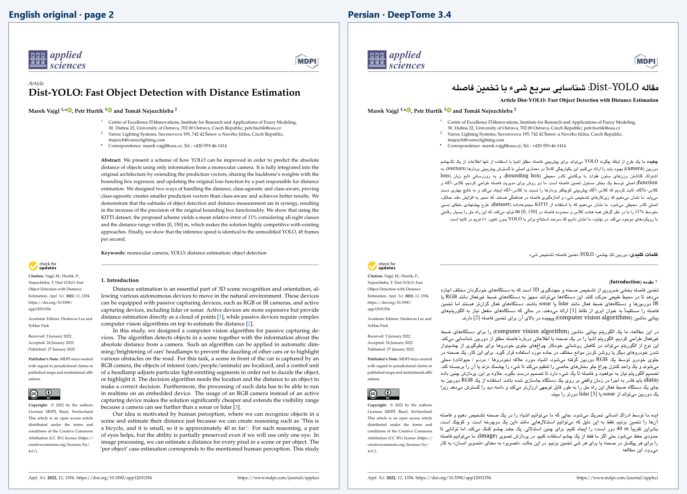
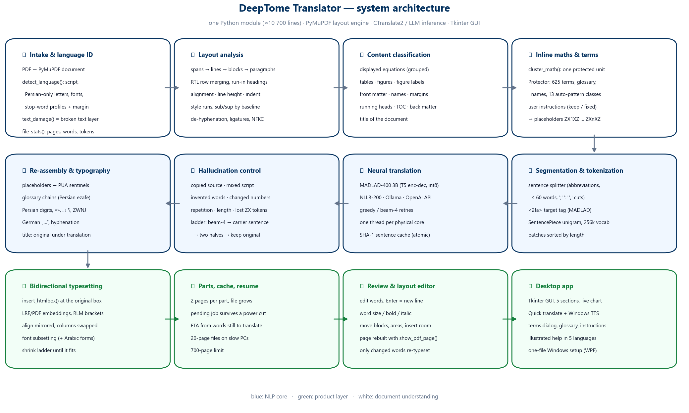
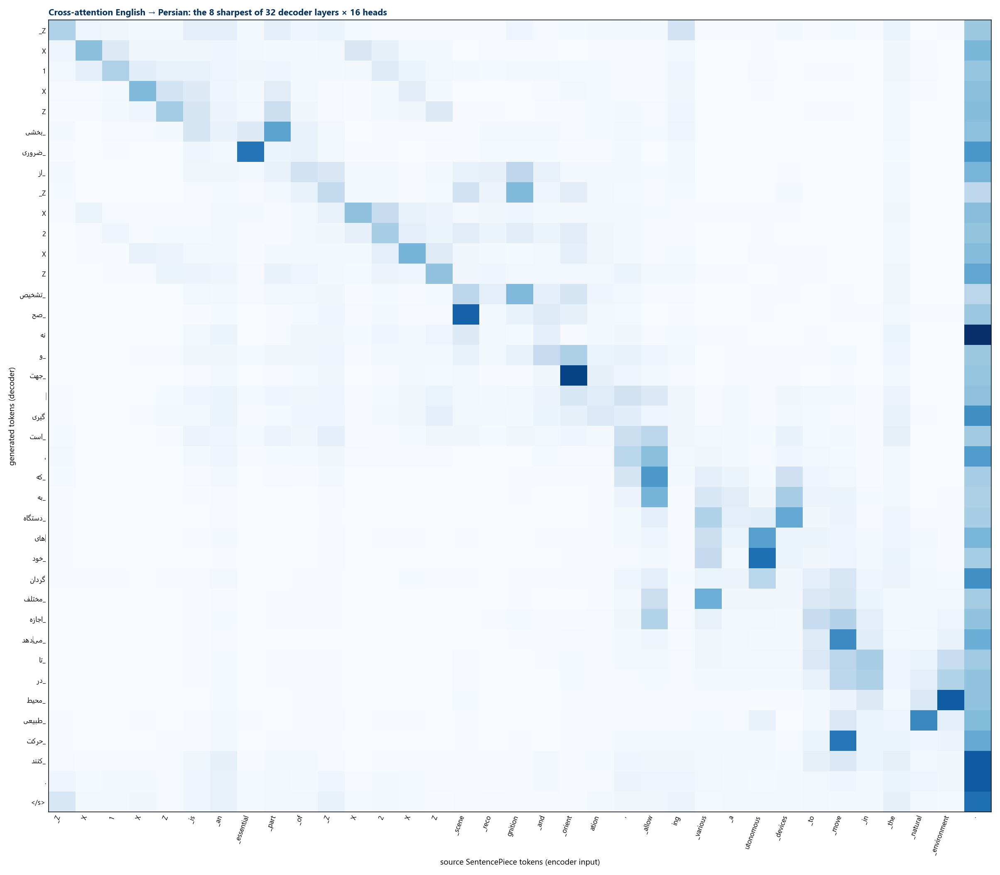
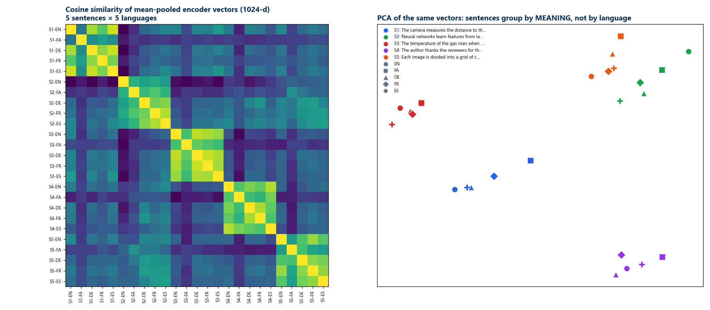

<!--
  File    : README_fa.md
  Author  : Hadi Sarhangi Fard
  Date    : 2026-11-21   (DeepTome Translator 3.4)
  Purpose : صفحهٔ فارسی پروژه - خلاصهٔ محصول، معماری NLP و راهنمای تصویری؛ جزئیات کامل در README.md (انگلیسی)
-->

  

<h2 align="center">ترجمهٔ ماشینی عصبی مقاله‌ها و کتاب‌های PDF با حفظ کامل صفحه‌آرایی</h2>

<a href="README.md">English (گزارش کامل مهندسی)</a>

## خلاصه

یک PDF علمی فقط متن نیست. ستون‌ها، فرمول‌های جدا و درون‌خطی، شکل‌ها، جدول‌ها، زیرنویس‌ها، ارجاع‌ها، یادداشت‌های حاشیه، نام نویسندگان و فهرست مراجع هم دارد. مترجم‌های آنلاین و دستیارهای گفتگو فقط **متن ساده** پس می‌دهند و صفحه از بین می‌رود.

**DeepTome** ساختار هر صفحه را می‌خواند و فقط متن اصلی را با یک مدل ترجمهٔ ماشینی عصبی ترجمه می‌کند. این مدل **بدون اینترنت روی CPU معمولی** اجرا می‌شود. ترجمه **در همان جای پاراگراف اصلی** و با همان اندازه، وزن، رنگ، تراز و فاصلهٔ سطرها نوشته می‌شود. فرمول‌ها، شکل‌ها و جدول‌ها همان اشیای برداری اصلی می‌مانند. برای فارسی صفحه آینه می‌شود: متن راست‌به‌چپ است، دو ستون جابه‌جا می‌شوند و کلمات انگلیسی جهت خودشان را حفظ می‌کنند. جهت برعکس (فارسی ← انگلیسی، آلمانی، فرانسوی، اسپانیایی) هم به همین شکل آینه می‌شود.

| | |
|---|---|
| زبان‌ها | انگلیسی، فارسی، آلمانی، فرانسوی، اسپانیایی؛ همهٔ جهت‌ها (۲۰ جفت). زبان فایل خودکار تشخیص داده می‌شود. |
| موتورها | MADLAD-400 3B / NLLB-200 داخلی (آفلاین)، Ollama (Gemma، Qwen …)، هر API سازگار با OpenAI |
| مدل | ۲٫۹۴ میلیارد پارامتر، واژگان ۲۵۶٬۰۰۰ قطعه‌ای SentencePiece؛ تبدیل یک‌باره به int8 (۲٫۷۷ گیگابایت) |
| سرعت (CPU چهارهسته‌ای) | ۸٫۴ توکن در ثانیه (حالت عادی)، ۵٫۱ توکن در ثانیه (Best quality) |
| پایداری | بخش‌های دوصفحه‌ای، حافظهٔ نهان جمله‌ها، ادامه پس از قطع برق، حداکثر ۷۰۰ صفحه |

## تازه‌های نسخهٔ ۳٫۵

* **فایل زیرنویس** (srt، vtt، ass، ssa، sbv، sub): خودکار تشخیص داده می‌شود و فقط متن گفتار ترجمه می‌شود. شماره‌ها، زمان‌ها، سبک‌ها و قالب فایل دست نمی‌خورند و خروجی یک فایل زیرنویس از همان نوع است.
* **ترجمهٔ همزمان**: پنجرهٔ ترجمهٔ سریع به دو نوار باریک تبدیل می‌شود که همیشه روی همهٔ پنجره‌ها می‌ماند. نوار بالا آنچه شنیده می‌شود (فیلم، ویدیو، تماس) و نوار پایین ترجمهٔ آن را نشان می‌دهد. کلید «خلاصه» جمله‌ها را کوتاه‌تر ترجمه می‌کند و متن هر روز در یک فایل txt با عنوان، تاریخ و ساعت ذخیره می‌شود.
* **صدا و میکروفن**: صداهای آفلاین Piper برای هر پنج زبان (نصب با Setup)، صداهای آنلاین Edge و صداهای ویندوز؛ تایپ با گفتار بدون محدودیت زمانی (Whisper آفلاین).
* **تنظیمات**: همهٔ اجزا (موتور، مدل‌ها، صداها، تشخیص گفتار) با وضعیت نصب و حجمشان؛ نصب و حذف هر کدام با یک کلیک.
* **ویرایشگر بازبینی زنده**: در هر لحظه فقط یک چیز انتخاب است و Esc انتخاب را پاک می‌کند. پاراگراف با ماوس جابه‌جا می‌شود؛ با کشیدن کادر دور هر بخش (مثلاً نام نویسندگان) آن بخش جابه‌جاشدنی می‌شود. کلیدهای جهت و ورود عدد X و Y (pt یا mm از گوشهٔ بالا-چپ صفحه) هم کار می‌کنند. هر تغییر همان لحظه دیده می‌شود و صفحه خودکار دوباره چیده می‌شود.
* **تایپ فارسی درست**: کادرهای متن از کنترل بومی ویندوز (RichEdit) استفاده می‌کنند و مکان‌نما و ترتیب حروف فارسی درست است.
* **شروع سریع‌تر**: موتور حدود دو دقیقه زودتر آماده می‌شود، چون توکن‌ساز MADLAD فقط با sentencepiece خوانده می‌شود.

| ترجمهٔ سریع | نوارهای ترجمهٔ همزمان |
|---|---|
|  |  |

| تنظیمات: اجزا | ویرایشگر بازبینی |
|---|---|
|  |  |

## نمایش

یک ترجمهٔ واقعی که فریم به فریم از پنجرهٔ برنامه ضبط شده است (با سرعت بیشتر): صفحه‌های ۲ و ۳ مقالهٔ Dist-YOLO، ترجمه به فارسی با موتور داخلی روی یک لپ‌تاپ چهارهسته‌ای بدون کارت گرافیک.

## پنجرهٔ اصلی

| | بخش | کار |
|---|---|---|
| A | سربرگ | ترجمهٔ سریع، File، Glossary، My instructions، Help، About |
| ۱ | Files | فایل ورودی، پوشهٔ خروجی، بازهٔ صفحه، قالب خروجی |
| ۲ | Languages | زبان مبدأ خودکار تشخیص داده می‌شود (همراه با صفحه، کلمه و توکن)؛ زبان مقصد را انتخاب می‌کنید |
| ۳ | Engine and fonts | موتور ترجمه، مدل، فونت عنوان و متن با نمونهٔ زنده، ضریب اندازهٔ فونت |
| ۴ | Options | ۱۵ گزینه (اصطلاحات، نام‌ها، جدول‌ها، مراجع، راست‌به‌چپ، جابه‌جایی ستون‌ها …) |
| ۵ | Text specialty | تا ۴ رشته؛ اصطلاحات تخصصی آن‌ها جمع‌آوری و حفظ می‌شود |
| B–E | RUN، وضعیت، نمودار حجم کار، گزارش | شروع، بهترین کیفیت، بازبینی اصطلاحات، ترجمه با بازبینی، زمان باقی‌مانده |

## خط لولهٔ NLP (خلاصه)

1. **تشخیص زبان:** فارسی از روی حروف خاص فارسی (پ چ ژ گ)، نام فونت‌ها و آسیب لایهٔ متن؛ زبان‌های لاتین از روی کلمات پرتکرار، با شرط اختلاف ۱٫۵ برابری.
2. **تحلیل صفحه‌آرایی:** از span به سطر، پاراگراف، تراز، فاصلهٔ سطر، تورفتگی و بالانویس/زیرنویس (از روی خط پایه).
3. **دسته‌بندی محتوا:** فرمول‌های جدا (گروه‌بندی‌شده)، جدول، شکل، نام نویسندگان، یادداشت حاشیه، عنوان، مراجع.
4. **ریاضی درون‌خطی:** هر عبارت ریاضی یک واحد محافظت‌شده می‌شود که با جمله حرکت می‌کند.
5. **محافظت از اصطلاحات:** ۶۲۵ اصطلاح داخلی، ۱۴۶ مدخل واژه‌نامهٔ فارسی، ۱۱۰ عنوان استاندارد و ۱۳ الگوی خودکار، که با نشانهٔ `ZXnXZ` پوشانده می‌شوند.
6. **جمله‌بندی و توکن‌سازی:** SentencePiece با برچسب زبان مقصد `<2fa>`.
7. **ترجمهٔ عصبی:** ترنسفورمر T5 با ۳۲+۳۲ لایه، بردارهای ۱۰۲۴ بعدی، ۱۶ سر توجه؛ CTranslate2 با وزن‌های int8.
8. **کنترل توهم:** ۹ آزمون روی هر جمله و نردبان تکرار (beam 4، جملهٔ حامل، دو نیمه، حفظ متن اصلی).
9. **حروف‌چینی دوجهته:** نشانه‌های یونیکد LRE/PDF/RLM، تراز آینه‌ای، زیرمجموعهٔ فونت همراه با حروف پیوستهٔ عربی.

## آزمایشگاه NLP (اندازه‌گیری واقعی)

توجه متقاطع (cross-attention) مدل کامل هنگام ترجمه به فارسی. نشانهٔ `ZX1XZ` قطعه به قطعه کپی می‌شود و ترتیب صفت و موصوف برعکس می‌شود (natural environment ← محیط طبیعی).

بردار جمله‌ها در ۵ زبان. شباهت کسینوسی برای یک جمله در زبان‌های مختلف **۰٫۸۵۴** است و برای جمله‌های متفاوت **۰٫۶۰۴**. فضای معنایی مدل به زبان وابسته نیست.

یک نمونهٔ واقعی از توهم مدل: عنوان «Institutional Review Board Statement» بدون بافت به «وب‌گاه رسمی شرکت رایتل» ترجمه شد. به همین دلیل ۱۱۰ عنوان استاندارد از جدول ثابت خوانده می‌شوند.

## نصب

فایل `DeepTome_Setup.exe` را از بخش **Releases** دریافت کنید. نصب‌کننده Python خصوصی، بسته‌ها و موتورها را نصب می‌کند و پیش از شروع، حجم دقیق دانلود را نشان می‌دهد.

## محدودیت‌ها

- ترجمه‌های روانِ اشتباه را همیشه نمی‌توان با قاعده تشخیص داد.
- جهت‌های بدون انگلیسی (مثلاً فارسی ← آلمانی) ضعیف‌ترند.
- سرعت روی CPU محدود است (حدود ۲ تا ۳ دقیقه برای هر صفحهٔ پرمتن).
- PDFهای اسکن‌شده ابتدا به OCR نیاز دارند.

فهرست کامل چالش‌های حل‌شده و مسائل باز در [README.md](README.md#part-iv-challenge-log) آمده است.

## مجوز و تماس

© 2026 Hadi Sarhangi Fard. All rights reserved.

GitHub: https://github.com/Hadifard · LinkedIn: https://www.linkedin.com/in/hadi-sarhangi-fard-mech-eng/

