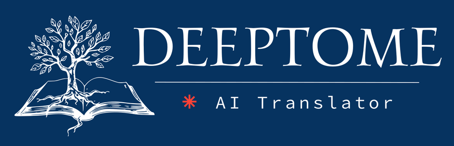
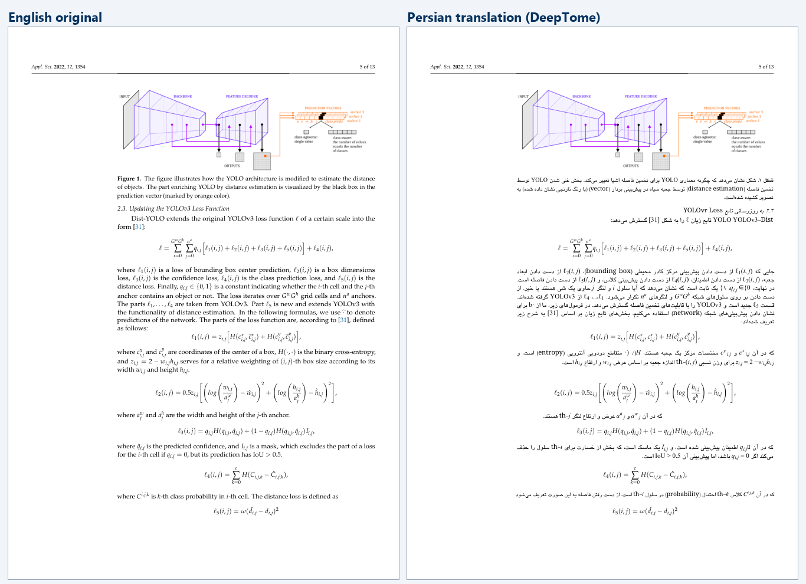

<!--
  File    : README_fa.md
  Author  : Hadi Sarhangi Fard
  Date    : 2026-11-19   (DeepTome Translator 3.4)
  Purpose : صفحهٔ فارسی پروژه در گیت‌هاب
-->

<div dir="rtl">

<p align="center">
  
</p>

<h3 align="center">ترجمهٔ ماشینی عصبی کتاب‌ها و مقاله‌های PDF با حفظ کامل صفحه‌آرایی</h3>

<p align="center"><a href="README.md">English</a></p>

## DeepTome چه می‌کند

سرویس‌های ترجمه فقط **متن** را ترجمه می‌کنند، اما یک PDF علمی بیش از متن است: دو ستون، فرمول‌های جدا و درون‌خطی،
شکل‌ها، جدول‌ها، زیرنویس‌ها، مراجع و اصطلاحات فنی‌ای که نباید ترجمه شوند.

DeepTome ساختار هر صفحه را می‌خواند، فقط متن اصلی را با یک مدل ترجمهٔ ماشینی عصبی ترجمه می‌کند و ترجمه را **در همان
جای پاراگراف اصلی** با همان اندازه، وزن، رنگ، تراز و فاصلهٔ سطرها می‌نویسد. شکل‌ها، فرمول‌ها و جدول‌ها همان اشیای
برداری اصلی می‌مانند. برای فارسی صفحه آینه می‌شود: راست‌به‌چپ، جابه‌جایی ستون‌ها و حفظ جهت کلمات انگلیسی داخل جمله.

زبان‌ها: **انگلیسی، فارسی، آلمانی، فرانسوی و اسپانیایی** - در هر دو جهت. زبان فایل خودکار تشخیص داده می‌شود.

<p align="center">
  
</p>

<sub>صفحهٔ ۶ مقالهٔ Dist-YOLO (Applied Sciences 2022، مجوز CC BY 4.0) که با مدل داخلی MADLAD-400 ترجمه شده است.</sub>

## نقاط قوت

- **حفظ صفحه‌آرایی:** هر پاراگراف با سبک اصلی در جای خودش؛ شکل و جدول و فرمول دست‌نخورده.
- **ریاضی سالم می‌ماند:** فرمول‌های جدا تشخیص داده و حفظ می‌شوند؛ ریاضی درون‌خطی مثل `σ ∈ [0, 1]` یک واحد محافظت‌شده است.
- **محافظت از اصطلاحات:** اصطلاحات فنی، نام‌ها، سرواژه‌ها، واحدها و فرمول‌ها پیش از ترجمه با نشانه‌های جایگزین (`ZX1XZ`) پوشانده می‌شوند.
- **کنترل توهم (hallucination):** هر جمله بررسی می‌شود (کپی متن مبدأ، کلمات ساختگی، تغییر اعداد، تکرار، حذف اصطلاح) و در صورت خرابی دوباره ترجمه می‌شود.
- **حروف‌چینی واقعی راست‌به‌چپ:** حروف و ارقام فارسی، نیم‌فاصله، علامت‌های جهت یونیکد، متن قابل جست‌وجو در PDF خروجی.
- **آفلاین و خصوصی:** موتور داخلی روی پردازندهٔ خود شما اجرا می‌شود؛ بدون حساب و کلید.
- **سه موتور:** MADLAD-400 / NLLB-200، Ollama (Gemma، Qwen) و هر API سازگار با OpenAI؛ با LLMها واژه‌نامه و دستورهای شما در پرامپت می‌رود.
- **مقاوم برای کتاب‌های بلند:** ترجمه در بخش‌های دوصفحه‌ای با حافظهٔ موقت؛ ادامه پس از قطع برق؛ تا ۷۰۰ صفحه.
- **ویرایشگر بازبینی و صفحه‌آرایی:** تغییر کلمات، Enter برای سطر جدید، اندازه و وزن کلمات انتخاب‌شده، فاصلهٔ سطرها، ارتفاع بلوک، درج یا حذف فاصله در صفحه، جابه‌جایی تصویر و جدول، نمادهای ریاضی.
- **ترجمهٔ سریع:** پنجره‌ای شبیه گوگل ترنسلیت با تشخیص زبان و تلفظ.
- **نصب با یک کلیک:** بدون نیاز به پایتون؛ حجم دانلود پیش از نصب دقیق نشان داده می‌شود.

## خط لولهٔ پردازش زبان طبیعی

```mermaid
flowchart LR
    A[PDF] --> B[تحلیل چیدمان]
    B --> C[دسته‌بندی بلوک‌ها]
    C --> D[تشخیص زبان]
    D --> E[جمله‌بندی]
    E --> F[محافظت از اصطلاحات]
    F --> G[توکن‌سازی زیرکلمه‌ای]
    G --> H[ترجمهٔ عصبی]
    H --> I[کنترل کیفیت]
    I --> J[بازگردانی و حروف‌چینی]
    J --> K[PDF و TXT]
```



## توکن‌سازی (Tokenization)

مدل‌های ترجمه کلمه یا حرف نمی‌خوانند، **توکن زیرکلمه‌ای** می‌خوانند. موتورهای داخلی از **SentencePiece** استفاده
می‌کنند: فاصله به نماد `▁` تبدیل می‌شود و یک واژگان آموخته‌شده متن را به قطعه‌ها می‌شکند. واژگان MADLAD-400
‏۲۵۶٬۰۰۰ قطعه دارد و برای همهٔ زبان‌ها مشترک است. زبان مقصد با برچسبی مثل `<2fa>` به مدل گفته می‌شود.

| زبان | توکن | کلمه | توکن بر کلمه |
|---|---:|---:|---:|
| انگلیسی | 17 | 10 | 1.70 |
| فارسی | 17 | 9 | 1.89 |
| آلمانی | 26 | 8 | 3.25 |
| فرانسوی | 24 | 14 | 1.71 |
| اسپانیایی | 21 | 14 | 1.50 |

شناسه‌ها و فرمول‌ها به قطعه‌های بی‌معنی زیادی شکسته می‌شوند (`▁Y | OLO | v | 3`)؛ به همین دلیل پیش از ترجمه با
نشانهٔ جایگزین پوشانده می‌شوند. برای دیدن مراحل روی متن خودتان:

```bash
python examples/tokenize_demo.py --text "متن یا جملهٔ شما"
```

نمونه‌کدهای بیشتر (Transformers، SentencePiece، NLLB و توابع خود DeepTome) در [README انگلیسی](README.md#tokenization---how-the-text-becomes-model-input) آمده است.

## نصب

**ویندوز با یک کلیک:** فایل `DeepTome_Setup.exe` را از بخش [Releases](../../releases) دریافت و اجرا کنید. اگر
هشدار «Windows protected your PC» آمد، روی **More info** و سپس **Run anyway** کلیک کنید.

| انتخاب | دانلود | فضای دیسک |
|---|---:|---:|
| Small - فقط برنامه | 0.33 GB | حدود 1.6 GB |
| Standard - موتور داخلی | 12.11 GB | حدود 4.4 GB |
| Advanced - همهٔ موتورها | 17.32 GB | حدود 12.8 GB |

**از سورس:**

```bash
python -m pip install -r requirements.txt
python book_translator.py
```

## محدودیت‌ها

- PDF باید متن واقعی داشته باشد؛ کتاب اسکن‌شده ترجمه نمی‌شود.
- جهت انگلیسی به فارسی بیشتر از بقیه آزمایش شده است.
- خروجی Word در این نسخه غیرفعال است.
- ویندوز صدای فارسی ندارد؛ متن فارسی در ترجمهٔ سریع تلفظ نمی‌شود.

## مجوز

© 2026 Hadi Sarhangi Fard. همهٔ حقوق محفوظ است - فایل [LICENSE](LICENSE) را ببینید. اجزای متن‌باز مجوز خودشان را
دارند (PyMuPDF با مجوز AGPL v3).

## سازنده

**Hadi Sarhangi Fard** - [GitHub](https://github.com/Hadifard) · [LinkedIn](https://www.linkedin.com/in/hadi-sarhangi-fard-mech-eng/)

</div>
